<div align="center">

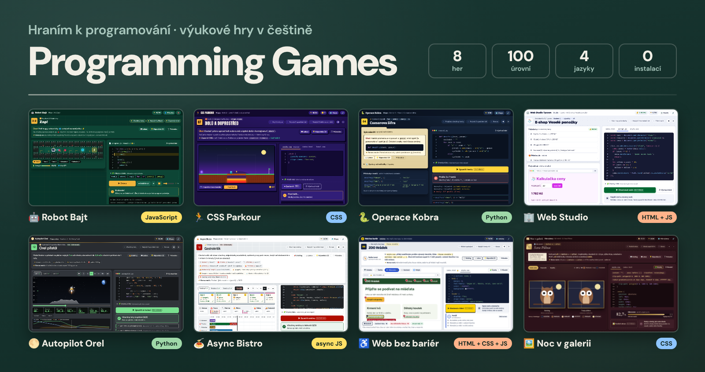

# 🎮 Programming Games

**Osm her, ve kterých se programovat učíš tím, že opravdu programuješ.**<br>
Píšeš skutečné HTML, CSS, JavaScript a Python a hra ti hned ukáže, co tvůj kód udělal.

[**▶ Hrát online**](https://rhazux.github.io/Programming-Games/) &nbsp;·&nbsp; [Hry](#hry) &nbsp;·&nbsp; [Jak se hraje](#jak-se-hraje) &nbsp;·&nbsp; [Měření pokroku](#mereni-pokroku) &nbsp;·&nbsp; [Jak to funguje](#jak-to-funguje) &nbsp;·&nbsp; [Spuštění](#spusteni)


</div>

---

## O projektu

Programming Games je sada osmi výukových her, které vznikly jako projekt do předmětu **4ITE PHR – EduGame**. Každá hra učí jeden jazyk nebo jedno téma a každý úkol se řeší **psaním skutečného kódu**. Žádné přetahování bloků ani výběr z možností: napíšeš kód, spustíš ho a hra ti hned ukáže výsledek, pochválí, co se povedlo, a česky vysvětlí, co opravit.

| | |
|---|---|
| 🎮 **8 her, 100 úrovní** | Robot Bajt má 16 misí, ostatní hry po 12 úrovních. |
| 🧠 **4 jazyky** | HTML, CSS, JavaScript a Python. Python běží přímo ve hře, nic se neinstaluje. |
| 📖 **Lekce ke každé úrovni** | Nová věc vysvětlená na živém příkladu, který si můžeš hned upravit a spustit. |
| 📈 **Měřitelný pokrok** | Vstupní a výstupní test, normalizovaný zisk, tabulka dovedností a export výsledků. |
| ♿ **Přístupnost** | Kontrast textu podle nejpřísnější normy WCAG AAA (7 : 1), ovládání klávesnicí, popisky pro čtečky, respekt k omezení pohybu. |
| 📦 **Bez instalace a závislostí** | Čisté HTML, CSS a JavaScript. Funguje online i po stažení dvojklikem na `index.html`. |

<a name="hry"></a>

## 🕹️ Hry

<table>
<tr>
<td width="50%" valign="top">

### 🤖 Robot Bajt
<a href="robot-bajt/">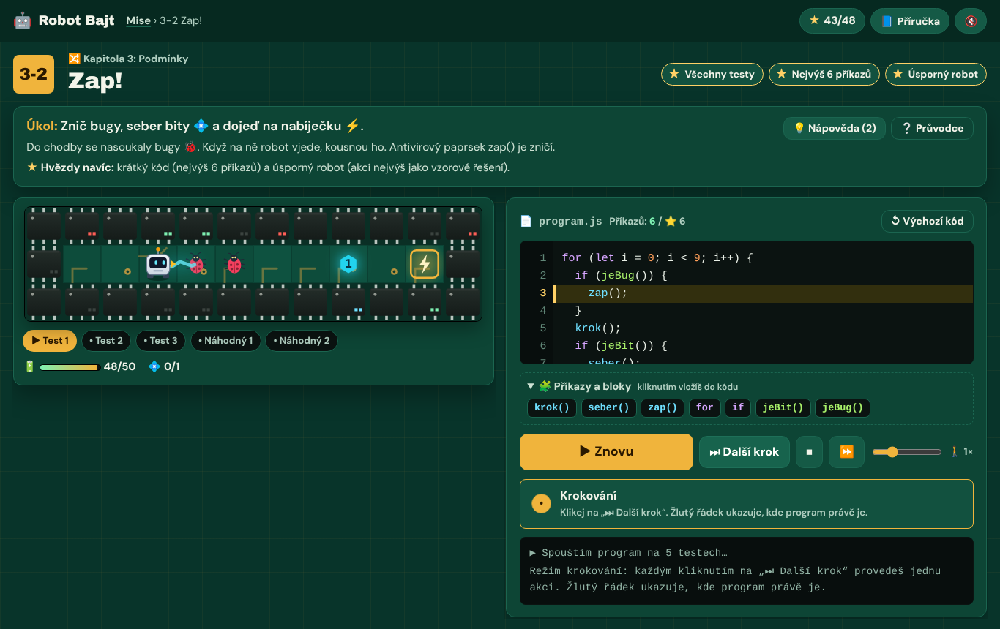</a>

**JavaScript · 16 misí · pro úplné začátečníky**

Píšeš program pro robota na desce plošných spojů: sbírá bity, ničí bugy a hledá nabíječku. Postupně se naučíš posloupnost příkazů, cykly `for` a `while`, podmínky, funkce a proměnné. Program jde krokovat jako v debuggeru a od třetí kapitoly ho hra testuje i na náhodných mapách.

[▶ Hrát](https://rhazux.github.io/Programming-Games/robot-bajt/) · [📘 Podrobnosti](robot-bajt/README.md)

</td>
<td width="50%" valign="top">

### 🏃 CSS Parkour
<a href="css-parkour/">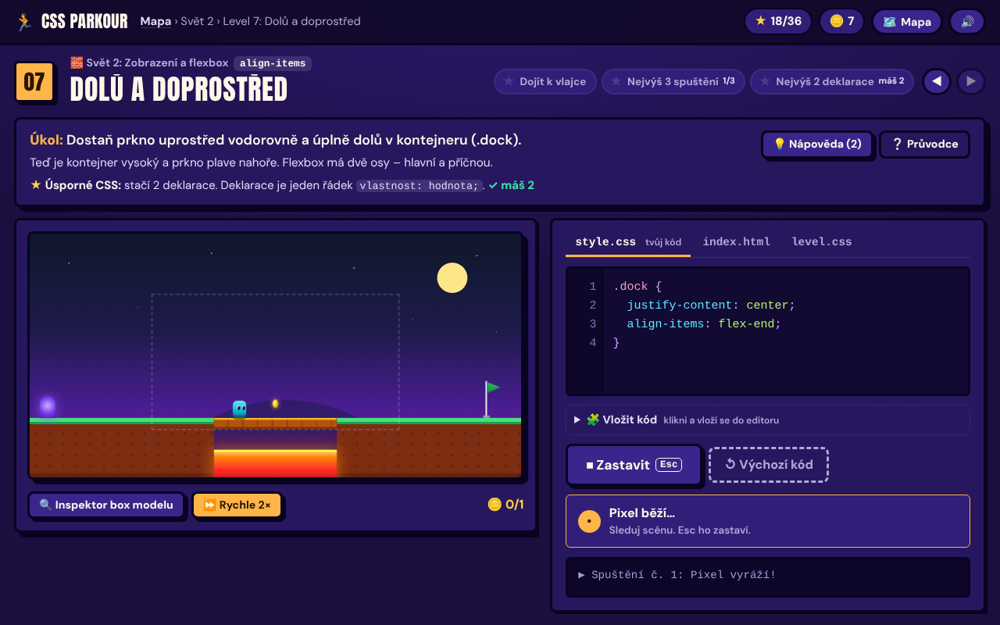</a>

**CSS · 12 levelů ve 3 světech**

Plošinovka, kde cestu přes lávu stavíš skutečným CSS. Rozměry a box model, `display` a `visibility`, flexbox, `position`, `transform`, specificita selektorů a animace přes `@keyframes`. Inspektor ukáže box model každého prvku.

[▶ Hrát](https://rhazux.github.io/Programming-Games/css-parkour/) · [📘 Podrobnosti](css-parkour/README.md)

</td>
</tr>
<tr>
<td width="50%" valign="top">

### 🐍 Operace Kobra
<a href="operace-kobra/">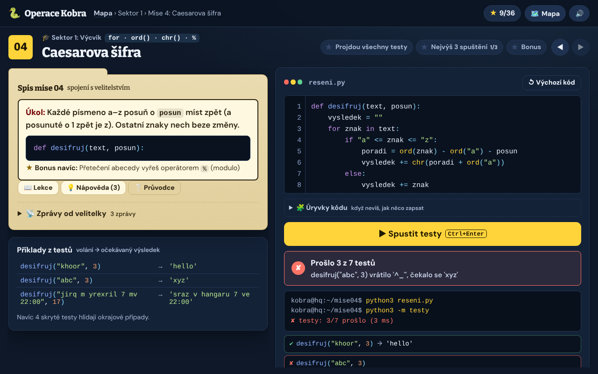</a>

**Python · 12 misí ve 3 sektorech**

Tajné kybernetické mise: síla hesla, Caesarova šifra, analýza logů, IP adresy v bitech, trezor, půlení intervalu a slovníkový útok. Funkce, podmínky, seznamy, slovníky, řezy a cykly. Testy kontrolují kód jako v praxi a chyby jsou stejné jako v CPythonu, jen s českým vysvětlením.

[▶ Hrát](https://rhazux.github.io/Programming-Games/operace-kobra/) · [📘 Podrobnosti](operace-kobra/README.md)

</td>
<td width="50%" valign="top">

### 🏢 Web Studio Tycoon
<a href="web-studio/">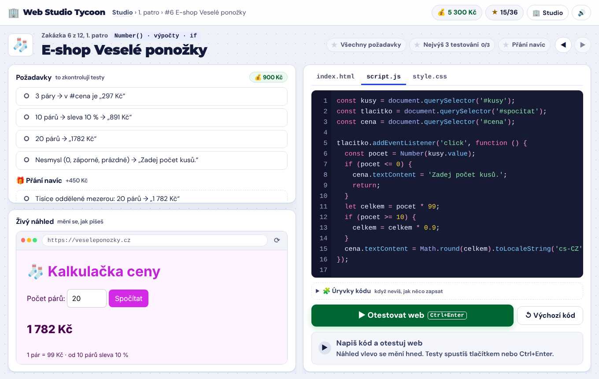</a>

**HTML + JavaScript · 12 zakázek ve 3 patrech**

Vedeš webové studio a stavíš weby pro klienty: struktura HTML, odkazy a formuláře, události, DOM, výpočty, validace, živé vyhledávání a košík. Testy web samy proklikají a za splněné požadavky dostaneš zaplaceno.

[▶ Hrát](https://rhazux.github.io/Programming-Games/web-studio/) · [📘 Podrobnosti](web-studio/README.md)

</td>
</tr>
<tr>
<td width="50%" valign="top">

### 🌕 Autopilot Orel
<a href="autopilot-orel/">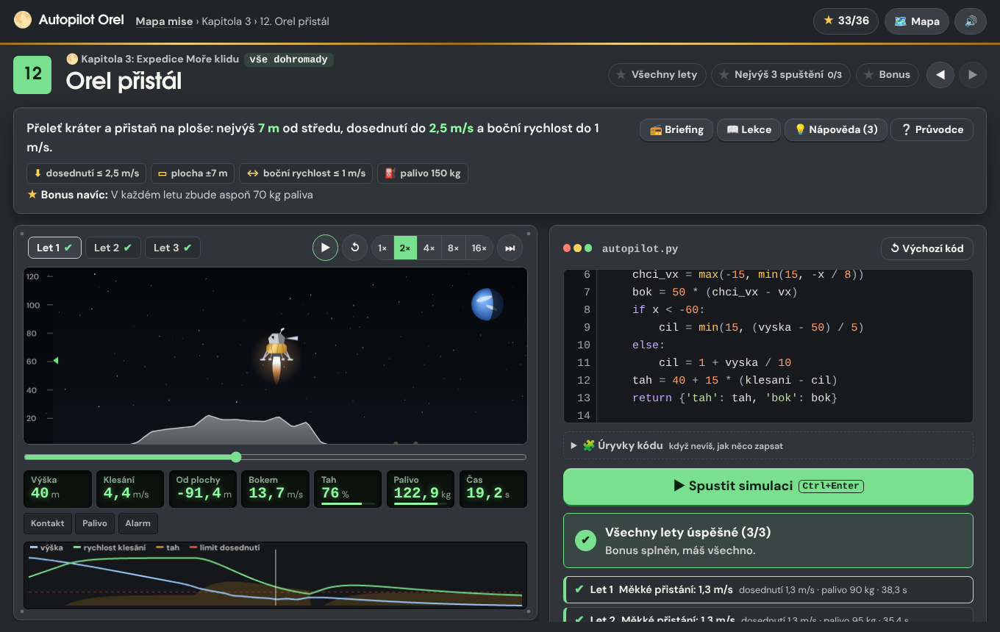</a>

**Python · 12 úrovní ve 3 kapitolách**

Píšeš palubní software přistávacího modulu na Měsíci. Tvoje funkce řídí motor desetkrát za sekundu a fyzikální simulace ukáže měkké přistání, nebo havárii. Podmínky, výpočty, regulátor, funkce, seznamy, slovníky a cyklus `while`.

[▶ Hrát](https://rhazux.github.io/Programming-Games/autopilot-orel/) · [📘 Podrobnosti](autopilot-orel/README.md)

</td>
<td width="50%" valign="top">

### 🍝 Async Bistro
<a href="async-bistro/">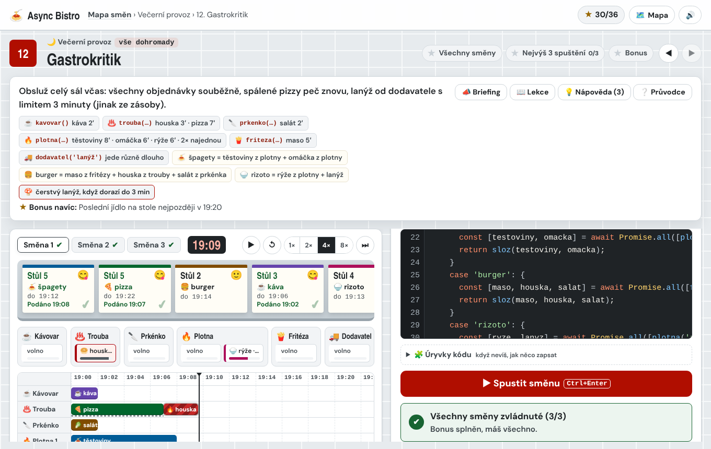</a>

**JavaScript (async) · 12 úrovní ve 3 směnách**

Řídíš kuchyni asynchronním JavaScriptem: `await`, `Promise.all`, `try/catch`, `Promise.race`, fronta a souběžní kurýři. Časová osa ukáže, co se vařilo souběžně, kdo čekal, co se spálilo a kdy jídlo dorazilo ke stolu.

[▶ Hrát](https://rhazux.github.io/Programming-Games/async-bistro/) · [📘 Podrobnosti](async-bistro/README.md)

</td>
</tr>
<tr>
<td width="50%" valign="top">

### ♿ Web bez bariér
<a href="web-bez-barier/">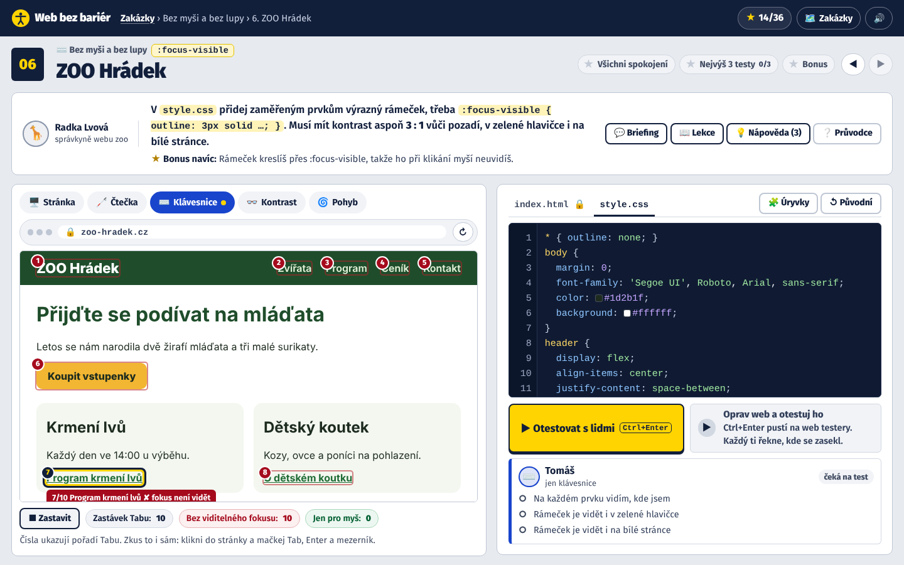</a>

**HTML + CSS + JavaScript · 12 zakázek ve 3 kapitolách**

Opravuješ weby, aby je zvládli čtyři testeři: Karel se čtečkou obrazovky, Tomáš jen s klávesnicí, slabozraká Jana a Eliška, které vadí pohyb. Alt texty, nadpisy, popisky polí, kontrast, viditelný fokus, ARIA a `prefers-reduced-motion`. Hra ukáže, co přesně z webu uslyší čtečka.

[▶ Hrát](https://rhazux.github.io/Programming-Games/web-bez-barier/) · [📘 Podrobnosti](web-bez-barier/README.md)

</td>
<td width="50%" valign="top">

### 🖼️ Noc v galerii
<a href="noc-v-galerii/">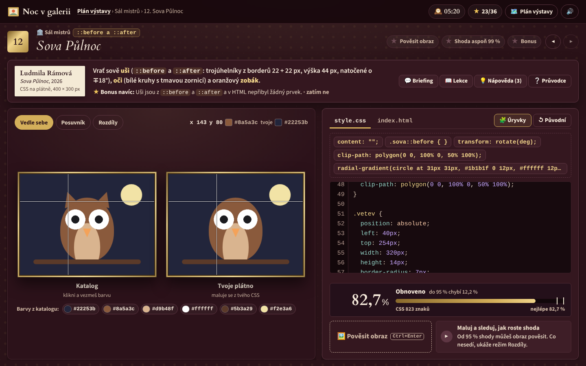</a>

**CSS · 12 obrazů ve 3 sálech**

Jako noční restaurátor(ka) domaluješ do rána dvanáct obrazů podle katalogu. Galerie porovná tvé plátno s předlohou pixel po pixelu. `border-radius`, pozicování, vrstvy, trojúhelníky z okrajů, přechody, stíny, `transform`, grid, `clip-path` a pseudoprvky.

[▶ Hrát](https://rhazux.github.io/Programming-Games/noc-v-galerii/) · [📘 Podrobnosti](noc-v-galerii/README.md)

</td>
</tr>
</table>

<a name="jak-se-hraje"></a>

## 🧭 Jak se hraje

Všechny hry mají stejnou kostru, takže kdo zvládne jednu, vyzná se i v ostatních.

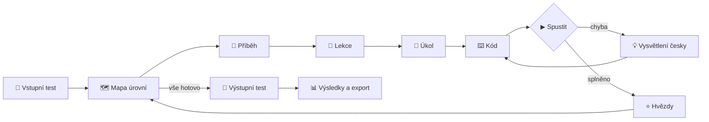

### Každá úroveň ve třech krocích

1. 💬 **Příběh**: postavy vysvětlí, o co jde a proč to potřebují.
2. 📖 **Lekce**: nová věc vysvětlená na vlastním příkladu, který si hned upravíš a spustíš. CSS se rovnou vykreslí, Python ukáže výstup, asynchronní kód časovou osu, u webů je vidět i to, co přečte čtečka, a robot Bajt příklad předvede na malé mapě. K lekci patří „🧪 Zkus si“, „⚠️ Pozor“ na nejčastější chybu a zajímavost ze skutečného světa. Příklad je schválně jiný než úkol, takže lekce učí, ale neprozradí řešení.
3. 🎯 **Úkol**: co přesně udělat a za co dostaneš každou ze tří hvězd.

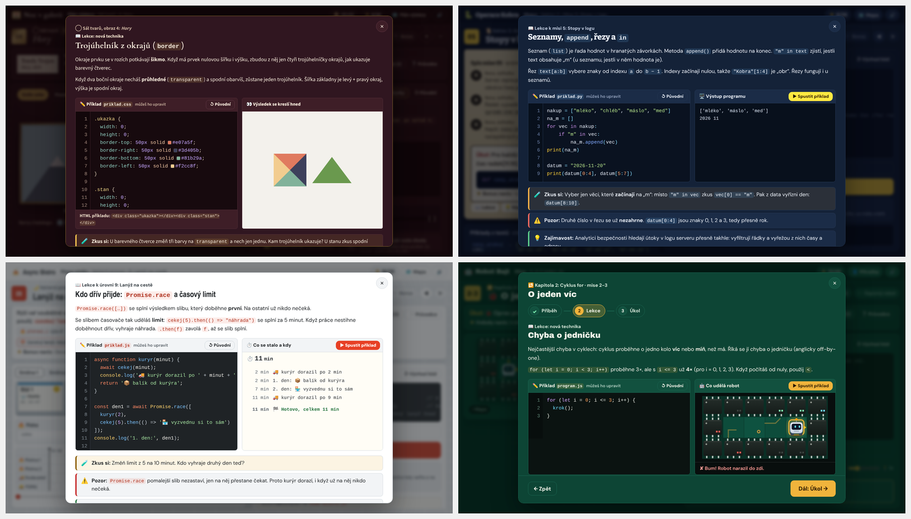

### Co mají hry společné

| Prvek | Co dělá |
|---|---|
| ⌨️ **Editor kódu** | Zvýraznění syntaxe, čísla řádků, automatické odsazení a vkládání hotových úryvků. |
| 💬 **Chyby česky** | Číslo řádku, co se stalo, proč a jak to opravit, i návrh opravy překlepu („Nemyslel(a) jsi `krok()`?“). Kód ve vysvětleních je zvýrazněný. Po spuštění je výsledek vždy vidět celý. |
| 💡 **Nápovědy** | Postupné nápovědy od jemného postrčení po skoro hotový kód, se zvýrazněným kódem. Vzorové řešení až nakonec. |
| ⭐ **Tři hvězdy** | Splnění, úspornost (třeba nejvýš 3 spuštění nebo krátký kód) a bonus navíc. Po výhře hra u každé hvězdy napíše, za co ji máš, a u chybějící poradí, jak ji získat. |
| ❔ **Průvodce** | V první úrovni provede obrazovkou krok po kroku. Spustit ho jde kdykoli znovu. |
| 📖 **Tahák a lekce** | Přehled všeho, co ses naučil(a), a lekce všech odemčených úrovní. Z lekce se tlačítkem vrátíš rovnou do taháku. |
| 🏅 **Odznaky a hodnosti** | Odměny za styl hraní, třeba za řešení bez nápovědy nebo na první pokus. |
| 💾 **Ukládání** | Postup se ukládá v prohlížeči, hru jde kdykoli přerušit. |

<a name="mereni-pokroku"></a>

## 📈 Měření pokroku

Každá hra měří, jestli se hráč opravdu něco naučil:

- **Vstupní a výstupní test**: 10 otázek na 10 dovedností ve dvou rovnocenných variantách A a B. Hráč dostane na začátek jednu a na konec druhou, takže výsledek nezkreslí zapamatované otázky. Volba „🤷 Nevím“ omezuje hádání.
- **Normalizovaný zisk** podle Hakea: `g = (po − před) / (1 − před)`, tedy jakou část toho, co hráč na začátku neuměl, se během hry naučil.
- **Tabulka dovedností** před a po: ↑ naučeno, ✓ umí, ✗ procvičit.
- **Herní metriky**: pokusy, nápovědy, čas, hvězdy, druhy chyb, které hráč potkal a opravil.
- **Export** všech výsledků do JSON pro další zpracování.

<a name="jak-to-funguje"></a>

## ⚙️ Jak to funguje

Hry jsou napsané v čistém HTML, CSS a JavaScriptu, bez frameworků, bez sestavování a bez jediné závislosti. Sdílejí společný základ: vzhled a rozvržení obrazovek (`css/base.css`), průvodce (`js/tour.js`) a lekce s živými příklady (`js/lesson.js`). Sedm her navíc sdílí sadu nástrojů pro kvíz, okna, zvuky a export (`js/kit.js`) a editor kódu (`js/editor.js`). Každá hra k tomu přidává vlastní herní engine:

| Hra | Srdce hry |
|---|---|
| 🤖 Robot Bajt | Vlastní interpret podmnožiny JavaScriptu (tokenizer, parser do AST, interpret s ochranou proti nekonečnému cyklu), simulace světa robota a animace na `<canvas>`. Testy na náhodných mapách s deterministickým generátorem. |
| 🏃 CSS Parkour | Scéna v `<iframe>` se skutečným CSS hráče, fyzika postavičky nad obdélníky prvků, zámky proti obcházení úkolu a deterministické animace přes Web Animations API. |
| 🐍 Operace Kobra | Interpret Pythonu napsaný v JavaScriptu (celá čísla libovolné velikosti, f-stringy, slovníky, množiny, closures, výjimky) s chybovými hláškami jako v CPythonu a testy funkcí proti vzorovému řešení. |
| 🏢 Web Studio Tycoon | Web hráče v `<iframe>`, testy, které klikají a píšou do polí, kontrola HTML a pojistka proti nekonečným cyklům. |
| 🌕 Autopilot Orel | Stejný interpret Pythonu, fyzika letu s krokem 0,1 s (měsíční gravitace, palivo, boční trysky) a vykreslení modulu, terénu a telemetrie. |
| 🍝 Async Bistro | Kuchyně s virtuálním časem: skutečné `Promise`, plánovač, který posouvá hodiny k další události, a záznam pro časovou osu. Pozná zapomenutý `await` i deadlock. |
| ♿ Web bez bariér | Strom přístupnosti, simulace čtečky obrazovky, pořadí Tabu, měření kontrastu podle WCAG a přepínání `prefers-reduced-motion`. |
| 🖼️ Noc v galerii | CSS hráče vykreslené přes SVG `foreignObject` na `<canvas>` a porovnané s katalogem pixel po pixelu, s režimem rozdílů a pipetou. |

## 📁 Struktura repozitáře

```
Programming-Games/
├── index.html              rozcestník všech her
├── README.md               tenhle soubor
├── Hry.code-workspace      pracovní prostor pro VS Code (F5 spustí vybranou hru)
├── docs/                   obrázky do README
├── robot-bajt/             🤖 JavaScript pro robota
├── css-parkour/            🏃 CSS plošinovka
├── operace-kobra/          🐍 Python a kyberbezpečnost
├── web-studio/             🏢 HTML a JavaScript pro klienty
├── autopilot-orel/         🌕 Python a přistání na Měsíci
├── async-bistro/           🍝 asynchronní JavaScript
├── web-bez-barier/         ♿ přístupnost webu
└── noc-v-galerii/          🖼️ CSS malování
```

Každá hra má stejnou vnitřní strukturu:

```
nazev-hry/
├── index.html          kostra aplikace
├── README.md           záměr, zábava, měřitelnost a technika hry
├── css/                společný základ (base.css) a vzhled hry (style.css)
├── js/                 aplikace, obsah úrovní, lekce, editor a herní engine
├── fonts/              přibalená písma s licencemi
├── screenshots/        obrázky do README
└── tests/              automatické testy
```

## 🆕 Poslední vylepšení

- **Kontrast AAA ve všech hrách.** Tlumené texty, komentáře v kódu, čísla řádků, tlačítka i barevné štítky mají kontrast aspoň 7 : 1.
- **Zvýrazněný kód všude, kde se o kódu mluví.** Úkoly, nápovědy, bonusy i chybové hlášky ukazují kód jako kód, ne jako obyčejný text.
- **Konkrétnější vysvětlení chyb.** CSS Parkour u každého levelu řekne, proč Pixel neprošel a co zkontrolovat. Chyby Pythonu, JavaScriptu a letu Orla mají zvýrazněný kód a opravené překlepy.
- **Úkol na prvním místě.** Operace Kobra a Web Studio ukazují úkol, požadavky a příklady nahoře, příběh je pod nimi. Robot Bajt má větší herní plochu a popsané ukazatele.
- **Výsledek je vždy vidět.** Vysvětlení po spuštění se nezkracuje a obrazovka se k němu posune.
- **Hry běží online** na [GitHub Pages](https://rhazux.github.io/Programming-Games/) a rozcestník ukazuje počet úrovní každé hry.

<a name="spusteni"></a>

## ▶️ Spuštění

- **Online:** [rhazux.github.io/Programming-Games](https://rhazux.github.io/Programming-Games/). Stačí prohlížeč, nic se neinstaluje.
- **Po stažení:** stáhni repozitář (*Code → Download ZIP*) nebo `git clone https://github.com/Rhazux/Programming-Games.git` a dvakrát klikni na `index.html`. Hry fungují i bez internetu a bez serveru.
- **Ve VS Code:** otevři `Hry.code-workspace`, stiskni `F5` a vyber hru. Otevře se v prohlížeči Chrome.

Funguje v aktuálních verzích Chrome, Edge a Firefoxu, na počítači i na mobilu.

## 🧪 Testy a kvalita

Každá hra má vlastní automatické testy. Ověřují, že vzorové řešení každé úrovně projde, výchozí kód a typické chyby začátečníků neprojdou, chybové hlášky jsou srozumitelné a každá lekce je úplná, její příklad je platný kód a neprozradí řešení.

| Hra | Spuštění | Kontrol |
|---|---|---:|
| 🤖 Robot Bajt | `node robot-bajt/tests/run-tests.js` | 189 |
| 🏃 CSS Parkour | otevři `css-parkour/tests/test.html` | 225 |
| 🐍 Operace Kobra | otevři `operace-kobra/tests/test.html` | 216 |
| 🏢 Web Studio Tycoon | otevři `web-studio/tests/test.html` | 193 |
| 🌕 Autopilot Orel | otevři `autopilot-orel/tests/test.html` | 174 |
| 🍝 Async Bistro | otevři `async-bistro/tests/test.html` | 175 |
| ♿ Web bez bariér | otevři `web-bez-barier/tests/test.html` | 260 |
| 🖼️ Noc v galerii | otevři `noc-v-galerii/tests/test.html` | 311 |
| **Celkem** | | **1 743** |

Kontrast všech textů ve všech hrách byl ověřený pixelovým auditem podle nejpřísnější úrovně WCAG 2 **AAA**: běžný text má kontrast aspoň 7 : 1, velký text aspoň 4,5 : 1, včetně oken, lekcí, tlačítek a stavů po spuštění. Jedinou záměrnou výjimkou je ukázka špatného kontrastu „Aa“ v lekci o kontrastu ve hře Web bez bariér, která má hráči ukázat, jak nečitelný text vypadá. Hry jdou ovládat klávesnicí, mají viditelný fokus, popisky pro čtečky obrazovky a respektují nastavení omezeného pohybu.

## 👤 Autor a licence

Projekt do předmětu **4ITE PHR – EduGame**. Autor: [@Rhazux](https://github.com/Rhazux).

Postavy, firmy a data ve hrách jsou smyšlené. Přibalená písma mají vlastní svobodné licence (SIL Open Font License a GUST Font License), jejich texty jsou ve složkách `fonts/` jednotlivých her.
