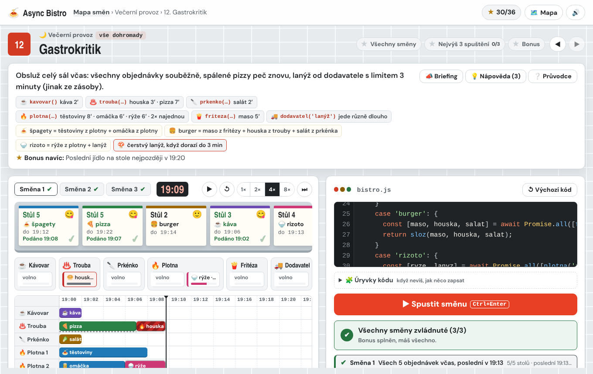
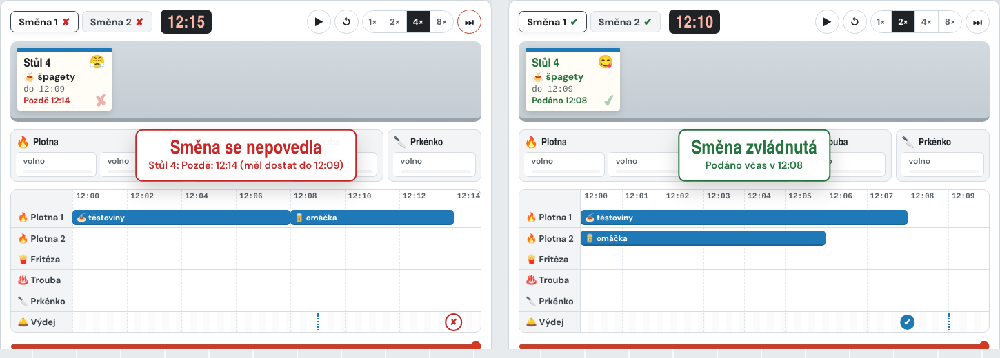
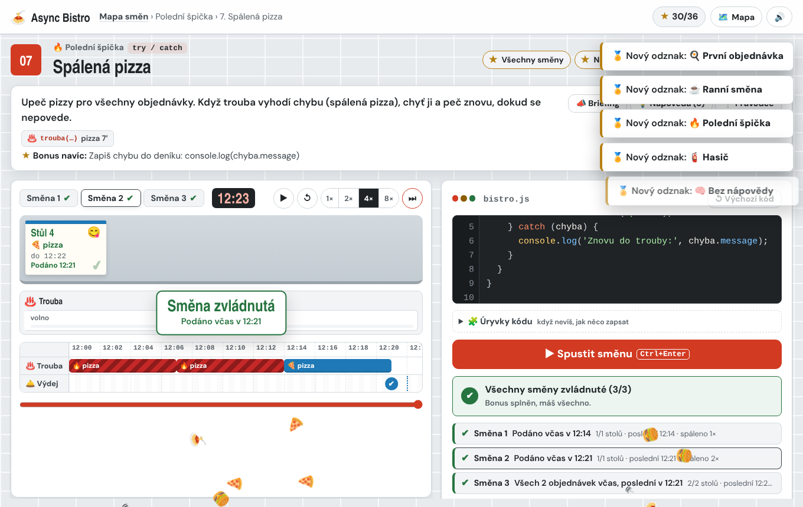
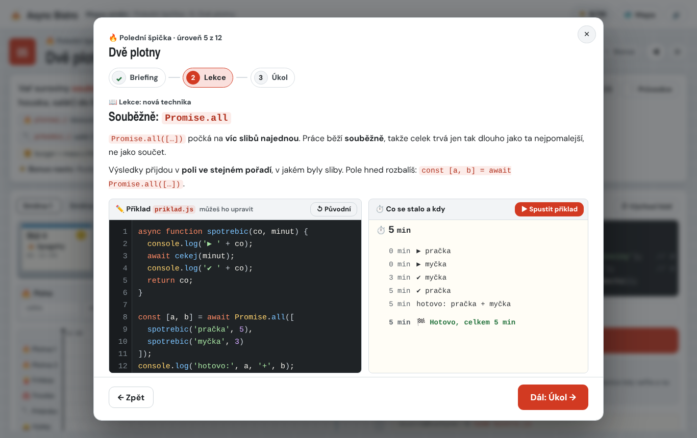
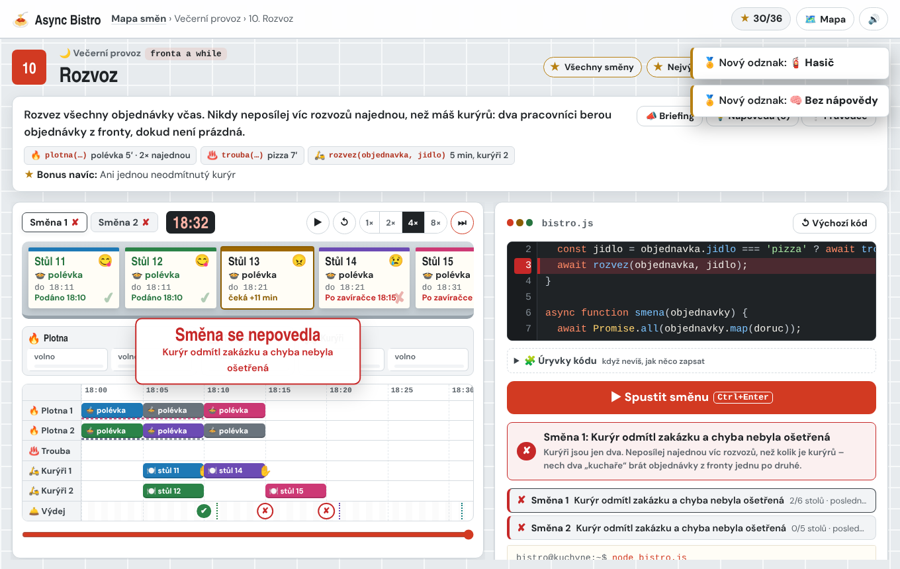
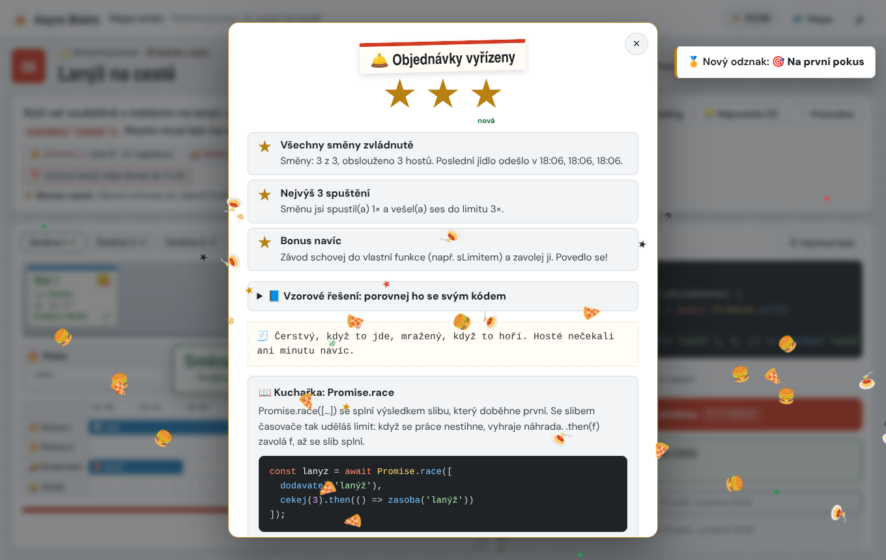
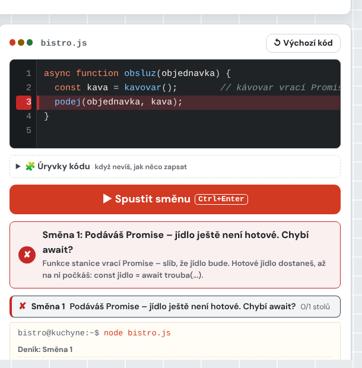

# 🍝 Async Bistro

**Vzdělávací hra, ve které se asynchronní JavaScript učíš vařením.** Vedeš kuchyni bistra: kávovar, trouba, dvě plotny, fritéza i kurýři poslouchají tvoje `async` funkce. Kdo zapomene `await`, podá hostovi místo jídla jen slib. Kdo vaří všechno po sobě, nestihne polední špičku. Kdo neošetří spálenou pizzu, tomu se zastaví celá směna. Každou minutu kuchyně uvidíš na časové ose.

- 🎮 **Hrát online:** https://UZIVATEL.github.io/async-bistro/
- 💻 **Zdrojový kód:** https://github.com/UZIVATEL/async-bistro

> Hra běží celá v prohlížeči. Kód hráče se spouští ve virtuálním čase, takže celá směna proběhne za zlomek sekundy a pak se přehraje jako film. Nepotřebuje server, instalaci ani internet (funguje i z `file://`).



---

## 🎯 Záměr

Asynchronní kód (`Promise`, `async/await`) je pro začátečníky jedna z nejtěžších částí JavaScriptu. Je neviditelný: program „někde čeká“, něco „běží souběžně“ a chyby se objevují jindy, než vznikly. Učebnice ho vysvětlují na `setTimeout` a `fetch`, kde výsledek není vidět.

Async Bistro dělá asynchronní kód viditelným:
- **Kuchyně je přirozený model asynchronního programu.** Stanice pracují samy a „slíbí“ jídlo (Promise). Kuchař buď čeká (`await`), nebo dá vařit víc věcí najednou (`Promise.all`). Trouba je jen jedna, takže se tvoří fronta. Dodavatel může přijet pozdě (`Promise.race` s časovačem) a trouba může jídlo spálit (`try/catch`).
- **Časová osa (Ganttův diagram)** ukazuje, kdy která stanice pracovala, kdo čekal ve frontě a kdy jídlo dorazilo k hostovi. Rozdíl mezi kódem „po sobě“ a „souběžně“ je vidět na první pohled:



- **Typické chyby mají jasné následky a české vysvětlení.** Chybějící `await` znamená „Podáváš Promise – jídlo ještě není hotové“. `forEach` s async funkcí vede k tomu, že směna skončila dřív, než se dovařilo. Neošetřený `reject` znamená spálenou pizzu a zastavenou kuchyni. Moc souběžných úloh skončí hláškou „Žádný volný kurýr“. Chyby syntaxe i běhu ukazují řádek v editoru.
- **Deterministický virtuální čas.** Stejný kód dá vždy stejný výsledek, takže se dá ladit a porovnávat a hra může férově hodnotit, jestli host dostal jídlo včas.

## 🕹️ Jak se hraje

1. **Vstupní test**: 10 otázek, asi 3 minuty.
2. **12 úrovní ve 3 směnách**: briefing od šéfkuchaře Bohouše a číšníka Pepy, zadání s kuchařkou (stanice, doby přípravy, recepty), editor s úryvky kódu. `Ctrl+Enter` odehraje všechny směny úrovně: lístky na lince se plní, stanice vaří, časová osa roste a hosté se usmívají, nebo mračí.
3. **Výstupní test a výsledky**: porovnání před/po, dovednost po dovednosti.

| Směna | Úrovně | JavaScript | Co se děje v kuchyni |
|---|---|---|---|
| ☕ 1 · Ranní | 1 Ranní káva · 2 Toust se sýrem · 3 Snídaňový lístek · 4 Ranní fronta | `await`, posloupnost kroků a `const`, objekty, `if`/`switch`, pole a `for…of`, šablonové řetězce | první káva, skládání jídla ze surovin, různé objednávky, fronta u pultu |
| 🔥 2 · Polední | 5 Dvě plotny · 6 Plný stůl · 7 Spálená pizza · 8 Stůl pro čtyři | `Promise.all` a rozbalení pole, `map` + `Promise.all`, `try/catch` a opakování ve smyčce, async funkce vracející hodnotu, `forEach` s indexem | dvě plotny najednou, celý stůl souběžně, trouba pálí pizzu, oslava, kde všichni jedí naráz |
| 🌙 3 · Večerní | 9 Lanýž na cestě · 10 Rozvoz · 11 Kdo spěchá · 12 Gastrokritik | `Promise.race` s časovačem a `.then`, fronta, `while` a `shift()`, dva souběžní „pracovníci“, `sort` s porovnávací funkcí, kopie pole `[...pole]`, všechno dohromady | pomalý dodavatel, jen dva kurýři, jedna trouba a hosté s různými limity, degustace pro gastrokritika |



### 📖 Příběh → Lekce → Úkol

Každá úroveň začíná ve třech krocích:

1. 💬 **Příběh**: o co jde a proč to postavy potřebují.
2. 📖 **Lekce**: nová věc vysvětlená na vlastním příkladu, který si můžeš hned upravit; příklad poběží s virtuálními minutami a časová osa ukáže, co se dělo souběžně a co čekalo. U lekce je i „🧪 Zkus si“, „⚠️ Pozor“ na nejčastější chybu a zajímavost ze skutečného světa. Příklad je schválně jiný než úkol, takže lekce učí, ale neprozradí řešení.
3. 🎯 **Úkol**: co přesně udělat a za co dostaneš každou ze tří hvězd.

Lekci otevřeš kdykoli znovu tlačítkem **📖 Lekce** a v taháku (příručce) jsou lekce všech odemčených úrovní.



## 🎉 Proč je to zábavné

- **Kuchyně žije.** Lístky na lince mají barvu stolu a hosté mění výraz: 🙂 čeká, 😠 čeká moc dlouho, 😋 dostal včas, 😤 pozdě, 🥶 vystydlo. Stanice ukazují, co se na nich zrovna vaří a kolik minut zbývá. Spálená pizza na ose zčervená a v kuchyni zazní poplach.
- **Přehrávání jako záznam směny**: rychlost 1× až 8×, posuvník času, skok na konec, přepínání mezi směnami, nástěnné hodiny kuchyně.
- **Atmosféra bistra**: bílé obklady se spárami, termotiskárna objednávek, deník jako účtenka, šéfkuchař a číšník v briefingu, finále s gastrokritikem.
- **Tři hvězdy za úroveň**: ★ za splnění, ★ za nejvýš 3 spuštění, ★ za bonus. Bonusy učí dobré návyky: `console.log` pro ladění, jen `const`, `switch`, šablonové řetězce, rozbalení výsledku `Promise.all`, `map` místo cyklu, výpis chyby z `catch`, vlastní funkce `sLimitem`, kopie pole před `sort`, rozvoz bez jediného odmítnutí kurýra.
- **12 odznaků a hodnosti** (🧽 Myčka nádobí → 👨‍🍳 Šéfkuchař Async Bistra), včetně odznaku *Slib není jídlo* za opravený chybějící `await`.
- **Férová pomoc**: tři nápovědy na úroveň, vzorové řešení až po opakovaném neúspěchu (a pak jen za 1 hvězdu), kuchařka se všemi stanicemi, recepty a tím, co se hráč naučil.
- **Hráč vždycky ví, co se děje.** V první úrovni ho provede průvodce obrazovkou (zadání, editor, spuštění, výsledky, hvězdy) a tlačítkem ❔ Průvodce si ho pustí kdykoli znovu. Bonus je vidět hned pod zadáním. Po vyřešení hra u každé hvězdy napíše, za co ji dostal, a u chybějící vysvětlí, jak ji získat, i s ukázkou kódu. Vzorové řešení si pak může rozbalit a porovnat se svým.



## 📈 Měřitelnost pokroku

**1. Vstupní a výstupní test (paralelní formy A/B)**
- 10 otázek na 10 dovedností: `await` a Promise, posloupnost kroků, objekty a podmínky, pole a `for…of`, `Promise.all`, `map` a šipkové funkce, `try/catch`, návratová hodnota async funkce, `Promise.race` a časovač, řazení pole.
- Hráč náhodně dostane variantu A nebo B na začátek a tu druhou na konec, takže výsledek nezkreslí zapamatované otázky. Odpovědi se míchají a volba **🤷 Nevím** omezuje hádání.
- **Normalizovaný zisk** (Hake): `g = (po − před) / (1 − před)` a **tabulka dovedností před/po** (↑ naučeno / umíš / procvičit).

**2. Herní metriky (pro každou úroveň)**
- počet spuštění do splnění a splnění na první pokus,
- použité nápovědy a zobrazení řešení,
- **počet jídel podaných pozdě** a **typy chyb JavaScriptu** (ReferenceError, SyntaxError, nekonečný cyklus…), které hráč potkal a překonal,
- čas posledního podaného jídla (efektivita kuchyně), zachráněné spálené pizzy,
- splněné bonusy a čas do splnění.

**3. Export**: *Stáhnout výsledky (JSON)* uloží testy a odpovědi, dovednosti, statistiky úrovní, typy chyb, odznaky a log událostí (spuštění, nápovědy, splnění).



## ⚙️ Jak to funguje technicky

- **Kuchyně s virtuálním časem (`js/kitchen.js`).** Každá stanice vrací skutečnou `Promise`, která se splní, až virtuální hodiny dojdou na konec přípravy. Plánovač drží seznam časovačů, posouvá hodiny vždy k nejbližší události a mezi kroky nechá doběhnout všechny rozpracované `await` (mikroúlohy). Výsledkem je přesný záznam: kdy se co zařadilo do fronty, začalo, skončilo, spálilo a komu bylo podáno.
- **Stanice s kapacitou a frontou**: dvě plotny, jedna trouba, dva kurýři (třetí rozvoz je odmítnut chybou), dodavatel s proměnnou dobou jízdy, zásoba, časovač `cekej()`, skládání jídel podle receptů `sloz()`.
- **Kontrola pravidel**: limit každé objednávky, podání po konci funkce (zapomenutý `await`), celý stůl najednou, čerstvý lanýž, správné jídlo pro správný stůl, jídla jen z kuchyně (žádné podvržené objekty).
- **Bezpečné spouštění**: kód hráče se přeloží jako skript se jménem `bistro.js` (chyby tak mají správné číslo řádku), cykly `while`/`for` dostanou pojistku proti nekonečnému běhu, deadlock (čekání na slib, který se nikdy nesplní) se pozná podle prázdného plánovače.
- **Bonusové cíle** se ověřují nad kódem (bez řetězců a komentářů) i nad záznamem směny (deník, odmítnutí kurýři, čas posledního jídla).
- **Bez závislostí**: čisté HTML/CSS/JS, `localStorage`, Web Audio, responzivní rozvržení, respektuje `prefers-reduced-motion`.



## 🧪 Testy

`tests/test.html` (otevři v prohlížeči) – **175 kontrol**:
- kuchyně: chybějící `await`, `Promise.all` (14 vs. 8 minut), fronta u obsazené stanice, spálená pizza, odmítnutý kurýr, práce po konci směny, deadlock, nekonečný cyklus s řádkem, chyba syntaxe s řádkem, pravidlo „celý stůl najednou“, čerstvý lanýž, `console.log` v deníku, neznámý recept,
- každá úroveň: vzorové řešení zvládne všechny směny i bonus, výchozí kód je spustitelný, ale úroveň nesplní, a typické chyby (`await` bez závorek, chybějící `await`, `forEach` s async, `=` místo `===`, jediný pokus místo smyčky, `return` zapomenutý v async funkci, `Promise.all` bez limitu kurýrů, obrácené řazení) neprojdou,
- vstupní a výstupní test: 10 otázek, platné odpovědi, každá dovednost právě jednou v obou variantách.
- **lekce**: každá úroveň má úplnou lekci (výklad, příklad, „Zkus si“, „Pozor“), příklad je platný kód, který jde spustit nebo vykreslit, a neprozradí řešení úrovně (jiné prvky a funkce, žádné opsané řádky).

## ▶️ Spuštění

- **Nejjednodušší:** otevři `index.html` v prohlížeči.
- **VS Code:** otevři složku a spusť přes *Run and Debug* (F5), nebo použij rozšíření *Live Server*.

### Nasazení na GitHub Pages

1. Vytvoř na GitHubu veřejný repozitář `async-bistro` a nahraj do něj obsah této složky (`index.html` v kořeni).
2. **Settings → Pages → Build and deployment → Source: Deploy from a branch**, větev `main`, složka `/ (root)` → **Save**.
3. Za minutu je hra na `https://UZIVATEL.github.io/async-bistro/`. Odkazy nahoře v README přepiš na skutečné.

## 📁 Struktura

```
async-bistro/
├── index.html          – kostra aplikace
├── css/base.css        – společná kostra obrazovek (lišta, kvíz, mapa, úroveň, výsledky)
├── css/style.css       – vzhled (kuchyňské obklady, lístky, stanice, časová osa)
├── fonts/              – DM Sans (SIL OFL) a TeX Gyre Heros Condensed (GUST Font License)
├── js/kit.js           – úložiště, zvuky, okna, kvíz, export
├── js/editor.js        – editor kódu se zvýrazněním JavaScriptu
├── js/kitchen.js       – kuchyně s virtuálním časem, stanice, pravidla, chyby česky
├── js/levels.js        – 12 úrovní, směny, objednávky, nápovědy, kvíz A/B
├── js/lessons.js       – lekce ke každé úrovni: výklad, příklad, zkus si, pozor
├── js/lesson.js        – společný úvod úrovně (Příběh → Lekce → Úkol) a živé příklady
├── js/app.js           – obrazovky, přehrávání směn, hvězdy, odznaky, měření, výsledky
├── tests/test.html     – automatické testy
├── tests/lessons-check.js– kontrola lekcí (úplnost, platný kód, neprozradí řešení)
└── screenshots/        – obrázky do README
```

---

Vytvořeno jako semestrální projekt **4ITE PHR – EduGame**. Bistro, šéfkuchař Bohouš, číšník Pepa i gastrokritik jsou smyšlení; žádné jídlo nebylo při vývoji spáleno doopravdy.
