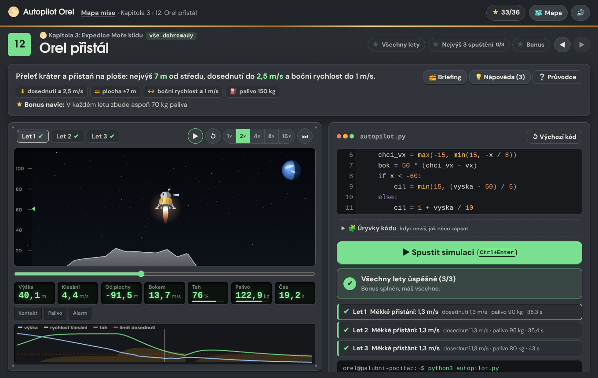
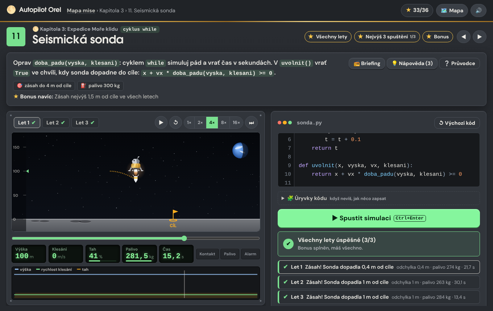
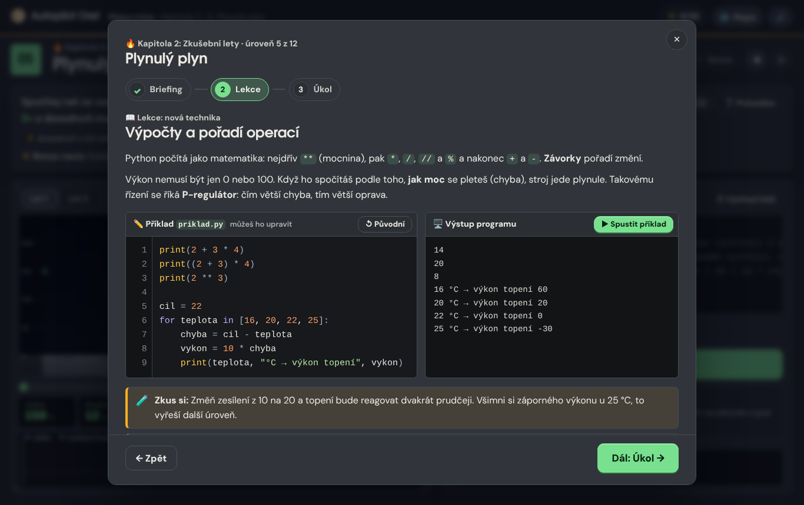
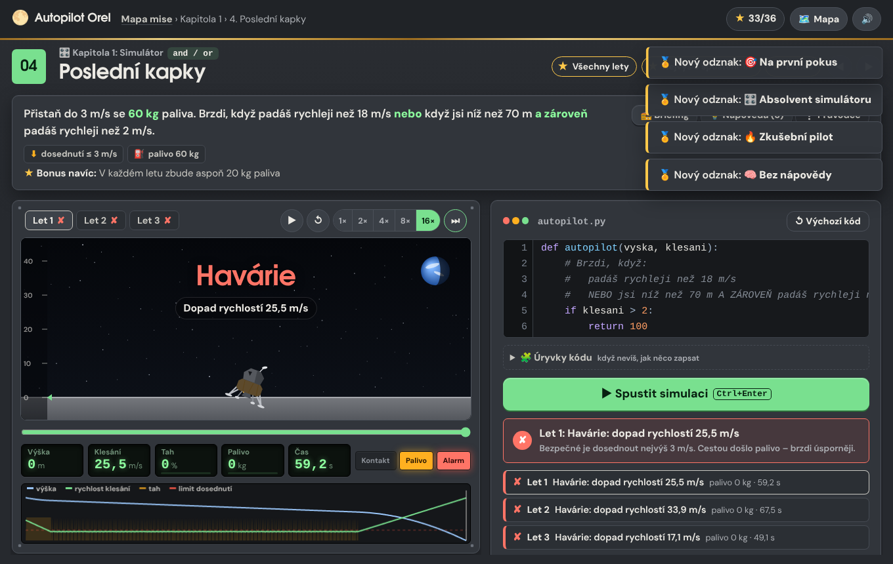
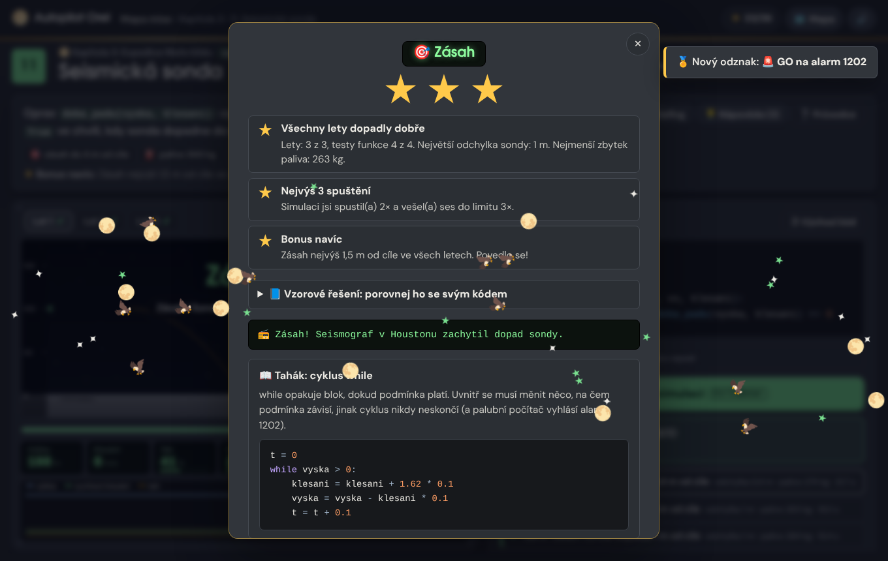
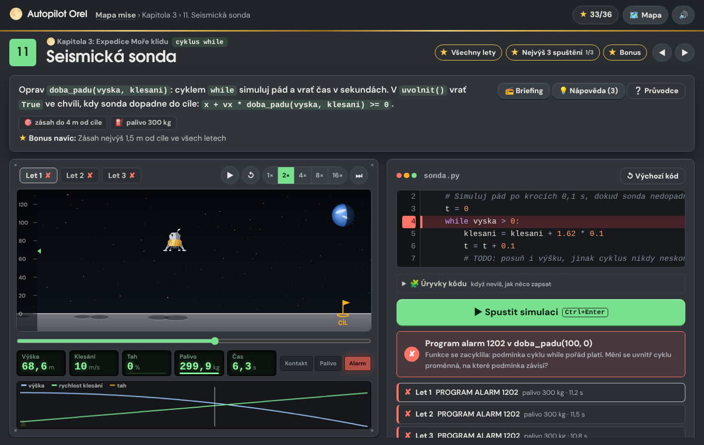

# 🌕 Autopilot Orel

**Vzdělávací hra, ve které se Python učíš psaním palubního softwaru přistávacího modulu.** Orel letí k Měsíci a v kabině nikdo nestihne řídit motor ručně. Píšeš **skutečný Python**, který desetkrát za sekundu rozhoduje o tahu motoru. Zabrzdíš volný pád, ušetříš poslední kapky paliva, přistaneš na ploše šikmým přiblížením, shodíš seismickou sondu přesně do kráteru a nakonec přeletíš balvany kráteru West a dosedneš v Moři klidu, stejně jako Apollo 11.

- 🎮 **Hrát online:** https://UZIVATEL.github.io/autopilot-orel/
- 💻 **Zdrojový kód:** https://github.com/UZIVATEL/autopilot-orel

> Hra běží celá v prohlížeči, včetně Pythonu a fyzikální simulace. Nepotřebuje server, instalaci ani internet (funguje i z `file://`).



---

## 🎯 Záměr

Většina úloh pro začátečníky v Pythonu končí výpisem čísla do konzole. Hráč nevidí, **co jeho kód způsobí**, a podmínky, výpočty nebo cykly zůstávají abstraktní.

Autopilot Orel dává kódu fyzické následky:
- **Program řídí stroj v reálném čase.** Funkce `autopilot(vyska, klesani)` se volá každých 0,1 s a její `return` je tah motoru. Když je hranice v `if` špatně, Orel narazí rychlostí 7 m/s. Když chybí závorky v `40 + 15 * (klesani - 2)`, dojde palivo. Každý řádek má viditelný důsledek.
- **Python, který dává smysl.** `elif` vybírá rychlostní pásmo podle výšky (jako program P64 Apolla), `and`/`or` spojí podmínky úsporného brzdění, `min`/`max` chrání motor, vlastní funkce `brzdna_draha(v)` počítá fyziku, n-tice vrací dva povely naráz, seznam je radarová mapa terénu, slovník je paměť mezi voláními a cyklus `while` simuluje pád sondy dopředu.
- **Ladění jako u inženýrů.** Graf výšky, rychlosti a tahu ukáže, proč let selhal: oscilace, příliš pozdní brzdění, prázdná nádrž. `print()` v autopilotu se zapisuje do palubního deníku s časem. Chyby Pythonu jsou vysvětlené česky i s řádkem a nekonečná smyčka vyhlásí skutečný **PROGRAM ALARM 1202**, stejný poplach, jaký zazněl při přistání Apolla 11.
- **Robustní kód, ne natvrdo zadané číslo.** Každá úroveň má tři lety s jinými podmínkami (výška, rychlost, stoupání, poloha). Projde jen program, který funguje obecně, stejně jako u testů v profesionálním vývoji.

## 🕹️ Jak se hraje

1. **Vstupní test**: 10 otázek, asi 3 minuty.
2. **12 úrovní ve 3 kapitolách**: rádiový briefing od Markéty (vedoucí palubního softwaru) a Řízení letu, zadání s pravidly letu, editor s úryvky kódu. `Ctrl+Enter` spustí simulaci všech letů a nejzajímavější let se hned přehraje: s plamenem motoru, prachem při dosednutí, telemetrií ve stylu palubního počítače DSKY a grafem.
3. **Výstupní test a výsledky**: porovnání před/po, dovednost po dovednosti.

| Kapitola | Úrovně | Python | Co se děje |
|---|---|---|---|
| 🎛️ 1 · Simulátor | 1 Zážeh · 2 Volný pád · 3 Tři pásma · 4 Poslední kapky | `return` a proměnné, `if/else`, `elif`, `and`/`or` | start z rampy, brzdění pádu, rychlostní profil s kontrolami ve 100 a 30 m, přistání s 60 kg paliva |
| 🔥 2 · Zkušební lety | 5 Plynulý plyn · 6 Meze motoru · 7 Brzdná dráha · 8 Na plochu | výpočty a pořadí operací, `min/max/round`, vlastní funkce a `**`, n-tice `return tah, bok` | motor vydrží jen 3 zapálení (P-regulátor místo zapnout/vypnout), přísný motor jen na celá čísla 0–100, hoverslam jako u raket Falcon 9, boční trysky a přesné přistání |
| 🌕 3 · Expedice Moře klidu | 9 Bezpečné místo · 10 Slepý radar · 11 Seismická sonda · 12 Orel přistál | seznam a `for`, `enumerate/zip`, slovník a `get()`, paměť mezi voláními, cyklus `while`, vše dohromady | výběr rovného místa z radarové mapy terénu, výpočet rychlosti z rozdílu výšek, předpověď dopadu sondy simulací, finále přes balvany kráteru West |



### 📖 Příběh → Lekce → Úkol

Každá úroveň začíná ve třech krocích:

1. 💬 **Příběh**: o co jde a proč to postavy potřebují.
2. 📖 **Lekce**: nová věc vysvětlená na vlastním příkladu, který si můžeš hned upravit; příklad se spustí v Pythonu přímo ve hře a ukáže svůj výstup. U lekce je i „🧪 Zkus si“, „⚠️ Pozor“ na nejčastější chybu a zajímavost ze skutečného světa. Příklad je schválně jiný než úkol, takže lekce učí, ale neprozradí řešení.
3. 🎯 **Úkol**: co přesně udělat a za co dostaneš každou ze tří hvězd.

Lekci otevřeš kdykoli znovu tlačítkem **📖 Lekce** a v taháku (příručce) jsou lekce všech odemčených úrovní.



## 🎉 Proč je to zábavné

- **Vidíš, co tvůj kód udělá.** Orel buď měkce dosedne a zvedne se prach, nebo vyhloubí nový kráter. Chyba je okamžitě vidět a zároveň je to legrace, takže selhání neodrazuje. Za 10 havárií je dokonce odznak *Kráterolog*.
- **Přehrávání jako na záznamu letu**: rychlost 1× až 16×, posuvník času, skok na konec, přepínání mezi lety. Telemetrie ukazuje výšku, rychlost klesání, tah, palivo a kontrolky *Kontakt / Palivo / Alarm*.
- **Atmosféra mise Apollo**: šedé panely kabiny se šroubky, zlatá fólie sestupového stupně, zelené číslice palubního počítače, Země nad obzorem a rádiové zprávy „Orle, tady Řízení“. Finále odkazuje na skutečný příběh Neila Armstronga, který v roce 1969 přeletěl kráter plný balvanů.
- **Tři hvězdy za úroveň**: ★ za splnění, ★ za nejvýš 3 spuštění, ★ za bonus. Bonusy střídají kvalitu letu (dosednout pod 2 m/s, ušetřit palivo, zásah do 1,5 m) a kvalitu kódu (bez `if` jen s `min/max`, další vlastní funkce, `enumerate/zip` místo `range(len())`, odhad rychlosti vrácený ve slovníku).
- **12 odznaků a hodnosti** (🧑‍🎓 Kadet → 🦅 Velitel mise Orel), zvuky, konfety a úvodní obrazovka, kde živě letí ukázkové finále řízené skutečným Pythonem.
- **Férová pomoc**: tři nápovědy na úroveň, vzorové řešení až po opakovaném neúspěchu (a pak jen za 1 hvězdu), tahák se vším, co se hráč naučil.
- **Hráč vždycky ví, co se děje.** V první úrovni ho provede průvodce obrazovkou (zadání, editor, spuštění, výsledky, hvězdy) a tlačítkem ❔ Průvodce si ho pustí kdykoli znovu. Bonus je vidět hned pod zadáním. Po vyřešení hra u každé hvězdy napíše, za co ji dostal, a u chybějící vysvětlí, jak ji získat, i s ukázkou kódu. Vzorové řešení si pak může rozbalit a porovnat se svým.



## 📈 Měřitelnost pokroku

**1. Vstupní a výstupní test (paralelní formy A/B)**
- 10 otázek na 10 dovedností: návratová hodnota, podmínky `if/elif/else`, logické operátory, výpočty a pořadí operací, vestavěné funkce, vlastní funkce, n-tice, seznamy a `for`, slovníky, cyklus `while`.
- Hráč náhodně dostane variantu A nebo B na začátek a tu druhou na konec, takže výsledek nezkreslí zapamatované otázky. Odpovědi se míchají a volba **🤷 Nevím** omezuje hádání.
- **Normalizovaný zisk** (Hake): `g = (po − před) / (1 − před)` a **tabulka dovedností před/po** (↑ naučeno / umíš / procvičit).

**2. Herní metriky (pro každou úroveň)**
- počet spuštění do splnění a splnění na první pokus,
- použité nápovědy a zobrazení řešení,
- **počet havárií** a **typy chyb Pythonu** (NameError, KeyError, SyntaxError, alarm 1202…), které hráč potkal a překonal,
- kvalita letu: nejměkčí dosednutí, zbylé palivo, přesnost zásahu,
- splněné bonusy a čas do splnění.

**3. Export**: *Stáhnout výsledky (JSON)* uloží testy a odpovědi, dovednosti, statistiky úrovní, havárie, typy chyb, odznaky a log událostí (spuštění, nápovědy, splnění).



## ⚙️ Jak to funguje technicky

- **Interpret Pythonu v JavaScriptu (`js/python.js`)**: stejný jako ve hře Operace Kobra, s chybovými hláškami jako v CPythonu a českým vysvětlením. Pro řídicí smyčku přibyla metoda `Runtime.call()`, která volá hráčovu funkci přímo s hodnotami (bez parsování), takže simulace tří letů trvá desítky milisekund.
- **Fyzika letu (`js/sim.js`)**: měsíční gravitace 1,62 m/s², motor s maximálním zrychlením 4 m/s² (vznášení při 40,5 % tahu), boční trysky, spotřeba paliva, krok 0,1 s (semi-implicitní Euler). Pravidla úrovní: limit dosednutí, kontrolní brány rychlosti, limit zapálení motoru, přísný rozsah tahu a celá čísla, přistávací plocha, sklon terénu, časové okno, zásah sondy.
- **Bezpečné spouštění**: každé volání autopilota má limit kroků. Nekonečná smyčka nezasekne prohlížeč, ale vyhlásí alarm 1202 a editor označí řádek s cyklem.



- **Vykreslení (`js/scene.js`)**: canvas s přistávacím modulem kresleným z cest (zlatá fólie, kabina, nohy, plamen podle tahu, boční trysky), terén, krátery, kamera, která se u povrchu přibližuje, částice prachu a exploze, graf telemetrie.
- **Bonusové cíle** se ověřují nad AST hráčova kódu (např. jestli autopilot nepoužívá `if`, nebo jestli volá další vlastní funkci) nebo nad záznamem letu (zbylé palivo, rychlost dosednutí, přesnost odhadu).
- **Bez závislostí**: čisté HTML/CSS/JS, `localStorage`, Web Audio, responzivní rozvržení, respektuje `prefers-reduced-motion`.

## 🧪 Testy

`tests/test.html` (otevři v prohlížeči) – **174 kontrol**:
- fyzika: vznášení, spotřeba paliva, volný pád, prázdná nádrž, alarm 1202, porucha motoru, chyba Pythonu s řádkem, `print()` v deníku, limit zapálení, přistání mimo plochu,
- každá úroveň: vzorové řešení proletí všemi lety a splní bonus, výchozí kód je spustitelný, ale úroveň nesplní, a typické chyby začátečníků (`<` místo `>`, chybějící závorky, `print` místo `return`, `<=` místo `<`, chybějící `max(0, …)`, nekonečný `while`, vzorec bez počáteční rychlosti) neprojdou,
- vstupní a výstupní test: 10 otázek, platné odpovědi, každá dovednost právě jednou v obou variantách.
- **lekce**: každá úroveň má úplnou lekci (výklad, příklad, „Zkus si“, „Pozor“), příklad je platný kód, který jde spustit nebo vykreslit, a neprozradí řešení úrovně (jiné prvky a funkce, žádné opsané řádky).

## ▶️ Spuštění

- **Nejjednodušší:** otevři `index.html` v prohlížeči.
- **VS Code:** otevři složku a spusť přes *Run and Debug* (F5), nebo použij rozšíření *Live Server*.

### Nasazení na GitHub Pages

1. Vytvoř na GitHubu veřejný repozitář `autopilot-orel` a nahraj do něj obsah této složky (`index.html` v kořeni).
2. **Settings → Pages → Build and deployment → Source: Deploy from a branch**, větev `main`, složka `/ (root)` → **Save**.
3. Za minutu je hra na `https://UZIVATEL.github.io/autopilot-orel/`. Odkazy nahoře v README přepiš na skutečné.

## 📁 Struktura

```
autopilot-orel/
├── index.html          – kostra aplikace
├── css/base.css        – společná kostra obrazovek (lišta, kvíz, mapa, úroveň, výsledky)
├── css/style.css       – vzhled (přístrojová deska lunárního modulu, DSKY, zlatá fólie)
├── fonts/              – DM Sans (SIL OFL) a TeX Gyre Adventor (GUST Font License)
├── js/kit.js           – úložiště, zvuky, okna, kvíz, export
├── js/editor.js        – editor kódu se zvýrazněním Pythonu
├── js/python.js        – interpret Pythonu (lexer, parser, interpret, chyby česky)
├── js/sim.js           – fyzika letu, řídicí smyčka, pravidla úrovní, testy pomocných funkcí
├── js/levels.js        – 12 úrovní, lety, terén, nápovědy, kvíz A/B
├── js/scene.js         – vykreslení letu a graf telemetrie
├── js/lessons.js       – lekce ke každé úrovni: výklad, příklad, zkus si, pozor
├── js/lesson.js        – společný úvod úrovně (Příběh → Lekce → Úkol) a živé příklady
├── js/app.js           – obrazovky, přehrávač, hvězdy, odznaky, měření, výsledky
├── tests/test.html     – automatické testy
├── tests/lessons-check.js– kontrola lekcí (úplnost, platný kód, neprozradí řešení)
└── screenshots/        – obrázky do README
```

---

Vytvořeno jako semestrální projekt **4ITE PHR – EduGame**. Mise Orel, postavy i lety jsou smyšlené; historické odkazy (Apollo 11, alarm 1202, kráter West, Moře klidu) vycházejí ze skutečného přistání v roce 1969.
