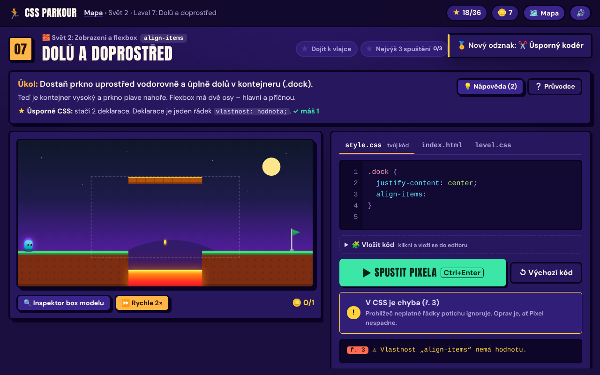
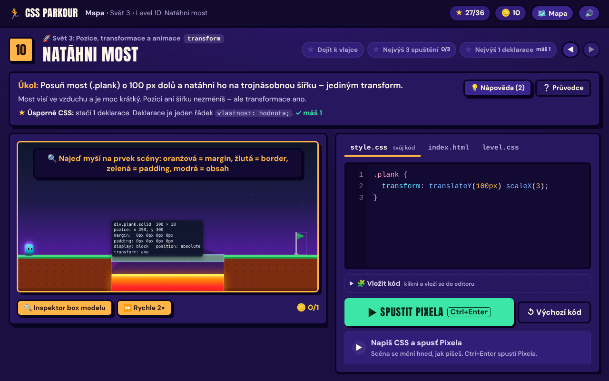
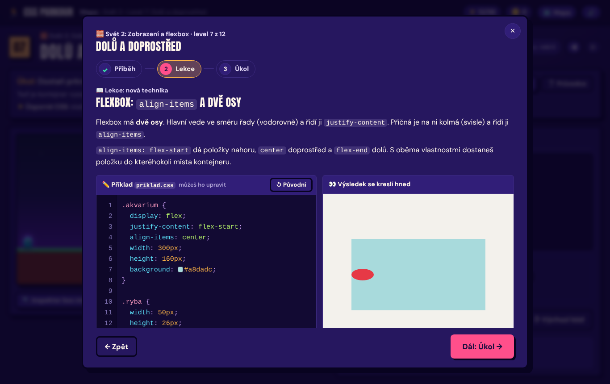
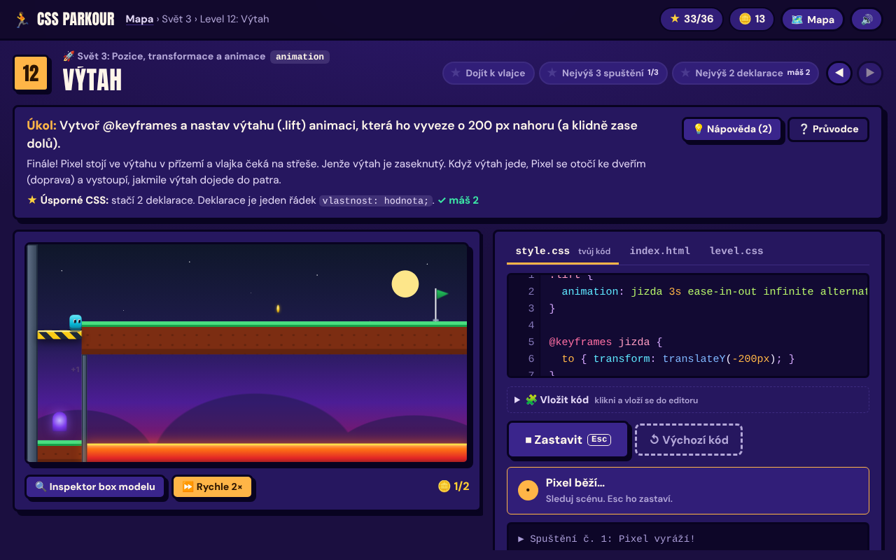
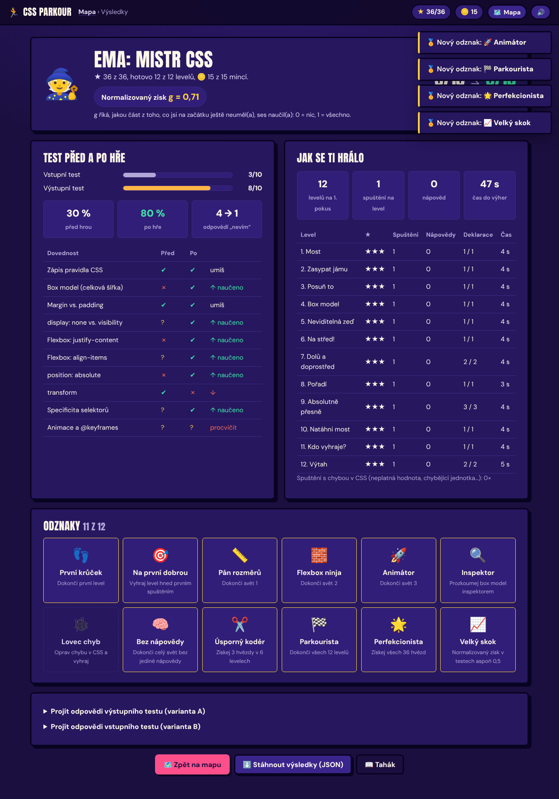

# 🏃 CSS Parkour

**Vzdělávací hra, ve které se CSS stává fyzikou.** Pixel umí jen chodit rovně – mosty, plošiny i výtahy mu postavíš skutečným CSS. Každý řádek, který napíšeš, okamžitě změní herní svět. Jedna chybějící jednotka `px` a Pixel skončí v lávě.

- 🎮 **Hrát online:** https://UZIVATEL.github.io/css-parkour/
- 💻 **Zdrojový kód:** https://github.com/UZIVATEL/css-parkour

> Hra běží celá v prohlížeči (HTML + CSS + JavaScript, bez knihoven a bez serveru). Postup se ukládá do `localStorage`.



---

## 🎯 Záměr

Začátečníci se CSS učí z tabulek vlastností a pak se diví, proč se prvek „nehýbe“: nerozumí box modelu, pletou si osy flexboxu, nevědí, od čeho se měří `position: absolute`, a netuší, proč jejich pravidlo „prohrálo“. Problém je v tom, že CSS je **neviditelné** – vidíš jen výsledek, ne příčinu.

CSS Parkour z rozvržení stránky dělá **terén**. Scéna hry je opravdová webová stránka v `<iframe>` a fyzika Pixela čte skutečné polohy prvků (`getBoundingClientRect`). Když hráč nastaví `.bridge { width: 320px; }`, most fyzicky vyroste a Pixel po něm přejde. Když napíše `width: 320` bez jednotky, prohlížeč řádek zahodí – a Pixel spadne do lávy. Hráč tak **na vlastní oči vidí, co CSS dělá**, a chyby mají okamžitý, srozumitelný (a vtipný) následek.

## 🕹️ Jak se hraje

1. **Vstupní test** – 10 otázek (asi 3 minuty), zjistí výchozí znalosti.
2. **12 levelů ve 3 světech** – v každém je úkol, scéna a editor `style.css`. Scéna se mění **už během psaní**. Až je cesta hotová, hráč spustí Pixela (`Ctrl+Enter`).
3. **Výstupní test a výsledky** – porovnání před/po, dovednost po dovednosti.

| Svět | Level | Co se hráč naučí |
|---|---|---|
| 📏 1 · Rozměry a box model | 1 Most · 2 Zasypat jámu · 3 Posuň to · 4 Box model | `width`, `height`, jednotky, `margin`, `padding` a celková šířka krabice |
| 🧱 2 · Zobrazení a flexbox | 5 Neviditelná zeď · 6 Na střed! · 7 Dolů a doprostřed · 8 Pořadí | `display: none` × `visibility: hidden` × `opacity`, `justify-content`, `align-items`, `order` |
| 🚀 3 · Pozice, transformace, animace | 9 Absolutně přesně · 10 Natáhni most · 11 Kdo vyhraje? · 12 Výtah | `position: absolute` a jeho předek, `transform`, specificita selektorů, `@keyframes` + `animation` |

Každý level je postavený tak, aby **typická chyba začátečníka prohrála**: v levelu 5 `display: none` posune víko z díry a Pixel spadne do lávy (správně je `visibility: hidden`), v levelu 9 most s `left: 300px` skončí jinde, protože se měří od bedny s `position: absolute`, v levelu 11 obyčejné `.plank { … }` prohraje se specifičtějším selektorem v `level.css`.



### 📖 Příběh → Lekce → Úkol

Každý level začíná ve třech krocích:

1. 💬 **Příběh**: o co jde a proč to postavy potřebují.
2. 📖 **Lekce**: nová věc vysvětlená na vlastním příkladu, který si můžeš hned upravit; CSS příkladu se hned vykresluje, takže je vidět, co která hodnota udělá. U lekce je i „🧪 Zkus si“, „⚠️ Pozor“ na nejčastější chybu a zajímavost ze skutečného světa. Příklad je schválně jiný než úkol, takže lekce učí, ale neprozradí řešení.
3. 🎯 **Úkol**: co přesně udělat a za co dostaneš každou ze tří hvězd.

Lekci otevřeš kdykoli znovu tlačítkem **📖 Lekce** a v taháku (příručce) jsou lekce všech odemčených úrovní.



## 🎉 Proč je to zábavné

- **Okamžitá zpětná vazba** – žádné „odevzdej a čekej“; most roste s každou číslicí, kterou hráč napíše.
- **Postavička a příběh** – Pixel, láva, bodáky, mince, vlajka a finále s výtahem, který hráč rozhýbe vlastní animací.
- **Vtipné, ale poučné neúspěchy** – „🔥 Pixel spadl do lávy! Tvoje CSS obsahuje chybu – prohlížeč neplatné řádky potichu ignoruje.“
- **Tři hvězdy za level** – ★ za vlajku, ★ za nejvýš 3 spuštění (přemýšlej, nehádej), ★ za úsporné CSS (nejvýš N deklarací).
- **12 odznaků** (Inspektor, Lovec chyb, Flexbox ninja, Perfekcionista…), hodnosti od 🐣 Začátečníka po 🧙 Mistra CSS, mince, zvuky a konfety.
- **Nástroje skutečného vývojáře** – 🔍 inspektor box modelu (margin/border/padding/obsah jako v DevTools), záložky `index.html` a `level.css`, zvýraznění syntaxe, čísla řádků, chyby s odkazem na řádek.
- **Nápovědy po kapkách** – dvě nápovědy na level, vzorové řešení až po opakovaném neúspěchu (a pak jen za 1 hvězdu).
- **Hráč vždycky ví, co se děje.** V první úrovni ho provede průvodce obrazovkou (zadání, editor, spuštění, výsledky, hvězdy) a tlačítkem ❔ Průvodce si ho pustí kdykoli znovu. Bonus je vidět hned pod zadáním. Po vyřešení hra u každé hvězdy napíše, za co ji dostal, a u chybějící vysvětlí, jak ji získat, i s ukázkou kódu. Vzorové řešení si pak může rozbalit a porovnat se svým.



## 📈 Měřitelnost pokroku

Hra měří znalosti **před a po** a zároveň sleduje, **jak hráč hraje**.

**1. Vstupní a výstupní test (paralelní formy A/B)**
- 10 otázek, každá míří na jednu dovednost (zápis pravidla, box model, margin × padding, display × visibility, justify-content, align-items, position, transform, specificita, animace).
- Dvě rovnocenné varianty testu: hráč náhodně dostane A nebo B na začátek a tu druhou na konec – výsledek tak nezkreslí zapamatování otázek.
- Pořadí odpovědí se míchá; možnost **🤷 Nevím** snižuje hádání (počet „nevím“ před/po je také ukazatel).
- **Normalizovaný zisk** (Hake): `g = (po − před) / (1 − před)` – jakou část z toho, co hráč na začátku neuměl, se naučil.
- **Tabulka dovedností před/po**: ✔ / ✗ / ? a trend (↑ naučeno, umíš, procvičit).

**2. Herní metriky (pro každý level)**
- počet spuštění do první výhry a výhra na první pokus,
- použité nápovědy a zobrazení řešení,
- spuštění s chybou v CSS (chybějící jednotka, neznámá vlastnost, chybějící středník…),
- počet platných deklarací vítězného CSS vůči limitu (elegance řešení),
- důvody neúspěchů (láva, bodáky, pád, zaseknutí),
- čas do vyřešení.

**3. Export** – tlačítko *Stáhnout výsledky (JSON)* uloží testy, odpovědi, dovednosti, statistiky levelů, odznaky a log událostí (spuštění, nápovědy, výhry). Vyučující tak může výsledky třídy sesbírat a porovnat.



## ⚙️ Jak to funguje technicky

- **Scéna = skutečné CSS.** Každý level je HTML v `<iframe srcdoc>`; styly se skládají z vrstev: vzhled scény → `level.css` → `style.css` hráče → zámky.
- **Fyzika nad layoutem.** Každý snímek se přečtou obdélníky prvků `.solid` (pevné), `.lift` (plošina, na kterou se dá naskočit shora), `.danger` (láva, bodáky), `.coin` a `#flag`. Pixel chodí, padá, vyjde malý schod, otáčí se u zdí a nechá se vézt plošinou.
- **Zámky proti obcházení.** Kulisy i klíčové vlastnosti mají pravidla s extrémní specificitou (`#stage#stage#stage #id#id#id { … !important }`), takže je hráč nepřepíše ani vlastním `!important` – úkol se musí vyřešit zamýšleným konceptem. Zamčené vlastnosti hra ukazuje v záložce `level.css`.
- **Deterministické animace.** CSS animace na scéně řídí hodiny simulace (Web Animations API: `pause()` + `currentTime`), takže stejný kód dá vždy stejný výsledek – i při zrychlení 2×.
- **Analýza CSS.** Vlastní parser najde neuzavřené bloky, chybějící dvojtečky a středníky; `CSS.supports()` odhalí neplatné hodnoty a chybějící jednotky; Levenshteinova vzdálenost navrhne opravu překlepu (`widht` → `width`); kontroluje se i to, zda selektor na scéně něco najde.
- **Bez závislostí.** Čisté HTML/CSS/JS, funguje z `file://` i na GitHub Pages, ukládá do `localStorage`, zvuky přes Web Audio API, responzivní (scéna 800×400 se zmenší na šířku telefonu, pruh *Vložit kód* usnadní psaní symbolů).
- **Přehledná obrazovka levelu.** Nahoře číslo a název level s hvězdami, pod tím zadání, vlevo scéna s Pixelem a vpravo kód. Pod editorem je velké tlačítko ▶ Spustit Pixela a hned pod ním stavový řádek, který řekne, co se stalo a co opravit. Na velké obrazovce se celý level vejde do okna bez posouvání.

## 🧪 Testy

`tests/test.html` (otevři v prohlížeči) automaticky ověří všech 12 levelů – **225 kontrol**:
- vzorové řešení vyhraje a sebere všechny mince, vejde se do limitu deklarací a nemá varování,
- výchozí kód i typické chyby (např. `width: 320` bez jednotky, `display: none` místo `visibility: hidden`, `order: -1`) prohrají,
- alternativní správná řešení projdou (např. `padding: 0 100px`, `flex-direction: row-reverse`, různé délky a průběhy animace výtahu),
- pokus přepsat kulisy (i s `!important`) nic nezmění,
- analyzátor CSS pozná chybějící jednotku, překlep, špatný selektor, chybějící dvojtečku/středník a závorky.
- **lekce**: každá úroveň má úplnou lekci (výklad, příklad, „Zkus si“, „Pozor“), příklad je platný kód, který jde spustit nebo vykreslit, a neprozradí řešení úrovně (jiné prvky a funkce, žádné opsané řádky).

## ▶️ Spuštění

- **Nejjednodušší:** otevři `index.html` v prohlížeči (Chrome, Edge, Firefox).
- **VS Code:** otevři složku a spusť přes *Run and Debug* (F5), nebo použij rozšíření *Live Server*.

### Nasazení na GitHub Pages

1. Vytvoř na GitHubu veřejný repozitář `css-parkour` a nahraj do něj obsah této složky (aby `index.html` byl v kořeni).
2. V repozitáři: **Settings → Pages → Build and deployment → Source: Deploy from a branch**, větev `main`, složka `/ (root)` → **Save**.
3. Za minutu je hra na `https://UZIVATEL.github.io/css-parkour/` (UZIVATEL = tvoje jméno na GitHubu). Odkazy nahoře v tomto README přepiš na skutečné.

## 📁 Struktura

```
css-parkour/
├── index.html          – kostra aplikace
├── css/base.css        – společná kostra obrazovek (lišta, kvíz, mapa, level, výsledky)
├── css/style.css       – vzhled hry (arkádový automat za soumraku)
├── fonts/              – písma DM Sans a Anton (licence SIL OFL)
├── js/kit.js           – úložiště, zvuky, okna, kvíz, export
├── js/editor.js        – editor kódu se zvýrazněním syntaxe
├── js/levels.js        – scéna, 12 levelů, tahák, testy A/B
├── js/engine.js        – scéna v iframe, fyzika, zámky, analýza CSS, inspektor
├── js/lessons.js       – lekce ke každé úrovni: výklad, příklad, zkus si, pozor
├── js/lesson.js        – společný úvod úrovně (Příběh → Lekce → Úkol) a živé příklady
├── js/app.js           – obrazovky, hvězdy, odznaky, měření, výsledky
├── tests/test.html     – automatické ověření levelů
├── tests/lessons-check.js– kontrola lekcí (úplnost, platný kód, neprozradí řešení)
└── screenshots/        – obrázky do README
```

---

Vytvořeno jako semestrální projekt **4ITE PHR – EduGame**.
