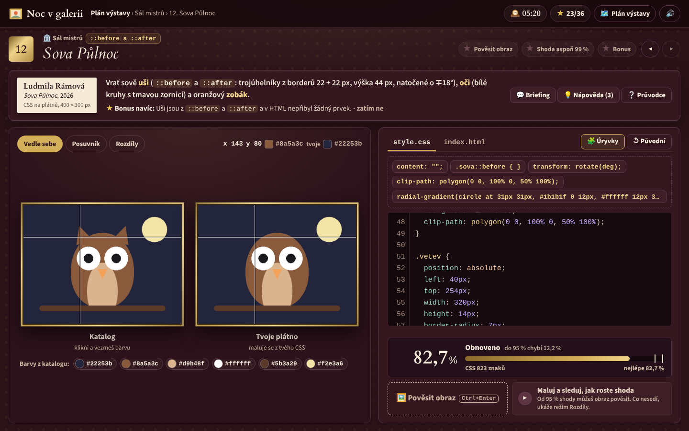
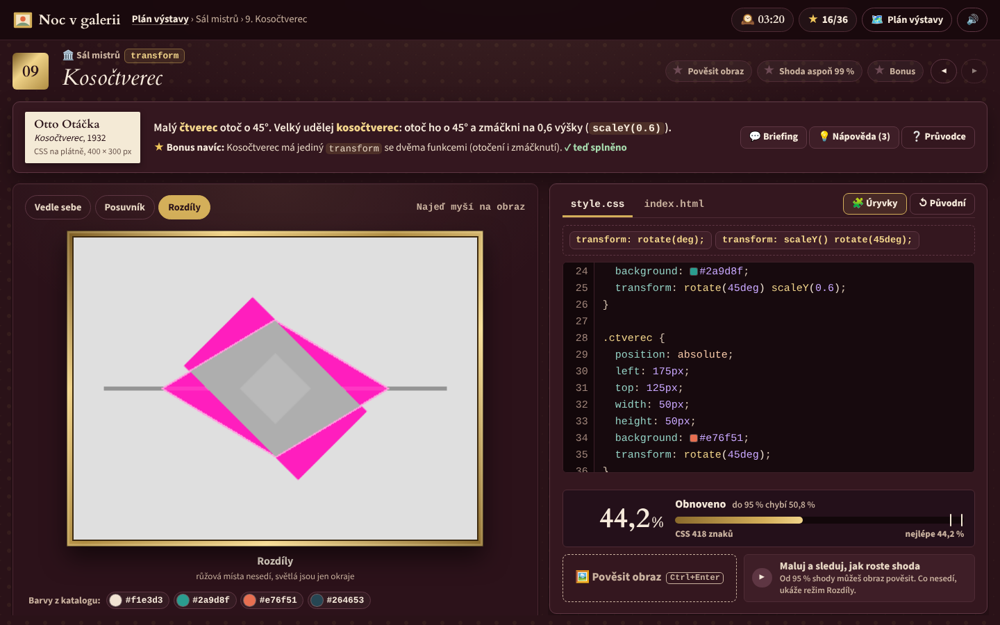
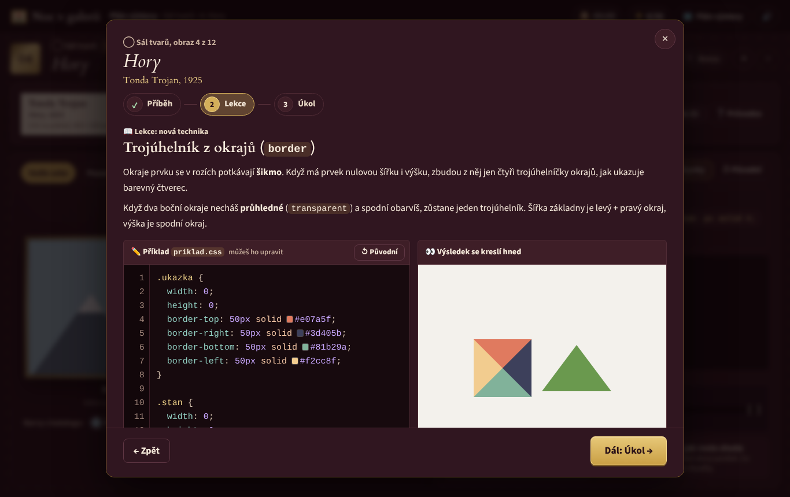
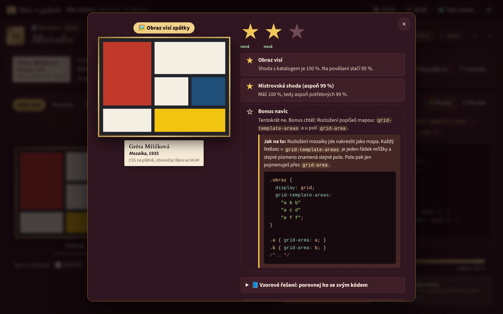
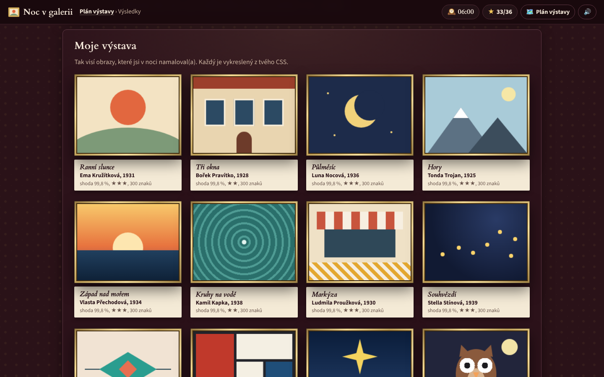

# 🖼️ Noc v galerii

**Vzdělávací hra, ve které přes noc zachraňuješ výstavu obrazů, a to v CSS.** Ráno v osm otevírá Galerie Hrádek výstavu *Geometrie snů*, jenže z obrazů v noci zmizely barvy a tvary. Zbyla jen vybledlá plátna a katalog s fotkami. Každý obraz je malý HTML dokument a ty ho domaluješ v **CSS**: kruhy, trojúhelníky, přechody, stíny, otáčení, mřížka i ořez. Galerie tvoje plátno porovná s katalogem **pixel po pixelu** a ukáže, na kolik procent je obraz obnovený.

- 🎮 **Hrát online:** https://UZIVATEL.github.io/noc-v-galerii/
- 💻 **Zdrojový kód:** https://github.com/UZIVATEL/noc-v-galerii

> Hra běží celá v prohlížeči, bez serveru a bez instalace (funguje i z `file://`). Tvoje HTML a CSS vykreslí přímo prohlížeč, takže platí všechno, co CSS skutečně umí, a projde každé správné řešení, ne jen jedno vzorové. Hraj v Chrome, Edge nebo Firefoxu. Safari nedovolí stránce číst pixely obrázku vykresleného z HTML, hra to pozná a upozorní na to.



---

## 🎯 Záměr

CSS se často učí jako seznam vlastností: `border-radius` zakulatí rohy, `z-index` mění vrstvy, `transform` otáčí. Proč ale `rotate(45deg) scaleY(0.6)` vypadá jinak než `scaleY(0.6) rotate(45deg)`, nebo proč je stín schovaný pod měsícem, člověk pochopí, až když to **vidí**. Noc v galerii proto učí CSS jako malování podle předlohy:

- **Jasný cíl bez dlouhého zadání.** Předloha visí vedle tvého plátna. Co chybí nebo nesedí, je hned vidět, a ukazatel *Obnoveno* reaguje na každou úpravu kódu.
- **Přesnost se měří, ne odhaduje.** Pravítko s pipetou ukáže souřadnice a barvu libovolného bodu v katalogu, režim *Rozdíly* obarví růžově přesně ta místa, která nesedí. Hráč se tak učí číst souřadnice a rozumět tomu, co jednotlivé vlastnosti dělají s obrazem.
- **Skutečné CSS.** Hráč píše normální kód do `style.css` (a když chce, upraví i `index.html`). Obraz kreslí sám prohlížeč, takže funguje cokoli: zkrácené zápisy, `inset`, proměnné, `calc()`, víc vrstev pozadí.
- **Od tvarů k mistrovským technikám.** Dvanáct obrazů ve třech sálech postupně přidá vždy jednu techniku a staví na předchozích. Poslední obraz, sova, spojí trojúhelníky z okrajů, přechody, ořez a pseudoprvky.

## 🕹️ Jak se hraje

1. **Vstupní test**: 10 otázek, asi 3 minuty.
2. **12 obrazů ve 3 sálech**: briefing s ředitelkou galerie a nočním hlídačem Bedřichem, zadání, stěna se dvěma plátny a editor `style.css` / `index.html` s úryvky kódu. Plátno se překresluje samo při psaní. Od **95 %** shody jde obraz **pověsit** (`Ctrl+Enter`).
3. **Výstupní test a tvoje výstava**: na stěně visí obrazy vykreslené z tvého CSS a vedle nich výsledky před/po.

| Sál | Obrazy | Technika |
|---|---|---|
| ◯ Sál tvarů | 1 Ranní slunce, 2 Tři okna, 3 Půlměsíc, 4 Hory | `border-radius`, `position: absolute` s `top`/`left`, pořadí vrstev a `z-index`, trojúhelník z okrajů |
| 🌅 Sál barev a světla | 5 Západ nad mořem, 6 Kruhy na vodě, 7 Markýza, 8 Souhvězdí | `linear-gradient` s ostrými přechody, `repeating-radial-gradient`, `repeating-linear-gradient` (pruhy pod úhlem), `box-shadow` jako kopie tvaru |
| 🏛️ Sál mistrů | 9 Kosočtverec, 10 Mozaika, 11 Severka, 12 Sova Půlnoc | `transform` (pořadí funkcí), `display: grid` s `fr`, `gap` a `span`, `clip-path: polygon()`, `::before` a `::after` |

**Stěna galerie má tři režimy porovnání:**
- **Vedle sebe**: katalog a plátno se zaměřovačem. Najetím myší vidíš souřadnice a barvu v katalogu i na svém plátně, kliknutím barvu zkopíruješ (pipeta). Z klávesnice: Tab na katalog, šipky a Enter.
- **Posuvník**: jedno plátno, kde jezdcem odkrýváš katalog přes tvůj obraz.
- **Rozdíly**: růžová místa nesedí, světlá jsou jen vyhlazené okraje tvarů.



### 📖 Příběh → Lekce → Úkol

Každý obraz začíná ve třech krocích:

1. 💬 **Příběh**: o co jde a proč to postavy potřebují.
2. 📖 **Lekce**: nová věc vysvětlená na vlastním příkladu, který si můžeš hned upravit; CSS příkladu se hned vykresluje, takže je vidět, co která hodnota udělá. U lekce je i „🧪 Zkus si“, „⚠️ Pozor“ na nejčastější chybu a zajímavost ze skutečného světa. Příklad je schválně jiný než úkol, takže lekce učí, ale neprozradí řešení.
3. 🎯 **Úkol**: co přesně udělat a za co dostaneš každou ze tří hvězd.

Lekci otevřeš kdykoli znovu tlačítkem **📖 Lekce** a v taháku (příručce) jsou lekce všech odemčených úrovní.



## 🎉 Proč je to zábavné

- **Malování, které hned vidíš.** Každá změna v kódu se do čtvrt sekundy objeví na plátně a ukazatel shody poskočí. Je to jako puzzle, kde kód skládá obraz.
- **Příběh s odpočtem.** Galerie začíná ve 22:00 a každý obnovený obraz posune noc o 40 minut. Mezi obrazy komentuje práci hlídač Bedřich („Ten kruh je kulatější než moje svačina.“) a autoři obrazů mají vlastní příběhy: Ema Kružítková, Bořek Pravítko, Luna Nocová, Gréta Mřížková a další.
- **Dvanáct různých obrazů**: východ slunce, dům s okny, srpek měsíce, hory se sněhem, západ nad mořem, vlny na vodě, markýza nad výlohou, souhvězdí, kosočtverec, mozaika ve stylu de Stijl, polární hvězda nad horami a sova s očima a ušima.
- **Tři hvězdy za obraz**: ★ za pověšení (95 %), ★ za mistrovskou shodu (99 %) a ★ za bonus. Bonusy učí jiný pohled na stejný obraz: barva přes pipetu, společné `top` v jedné třídě, srpek bez `z-index` jen pořadím v HTML, barvy v proměnných, **zlatý rám** (celé CSS do limitu znaků, pomůže `inset` a zkrácené zápisy), kapka jako další vrstva pozadí, sedm hvězd z jediného prvku, jeden `transform` se dvěma funkcemi, mapa `grid-template-areas`, uši sovy z pseudoprvků.
- **12 odznaků a hodnosti** (🧹 Pomocník v depozitáři → 🏛️ Hlavní kurátor galerie), mezi nimi *Oko restaurátora* za hledání chyb v režimu Rozdíly a *Ráno včas* za celou výstavu.
- **Férová pomoc**: tři nápovědy ke každému obrazu, vzorové řešení až po všech nápovědách (a pak jen za 1 hvězdu), Příručka restaurátora se vším, co ses naučil(a), a česká kontrola CSS přímo pod editorem.
- **Hráč vždycky ví, co se děje.** V první úrovni ho provede průvodce obrazovkou (zadání, editor, spuštění, výsledky, hvězdy) a tlačítkem ❔ Průvodce si ho pustí kdykoli znovu. Bonus je vidět hned pod zadáním. Po vyřešení hra u každé hvězdy napíše, za co ji dostal, a u chybějící vysvětlí, jak ji získat, i s ukázkou kódu. Vzorové řešení si pak může rozbalit a porovnat se svým.



## 📈 Měřitelnost pokroku

**1. Vstupní a výstupní test (paralelní formy A/B)**
- 10 otázek na 10 dovedností: kruh a zakulacení, umístění, vrstvy a pořadí, trojúhelník z okrajů, přechody, stíny, transformace, mřížka, ořez a pseudoprvky.
- Hráč náhodně dostane variantu A nebo B na začátek a tu druhou na konec, takže výsledek nezkreslí zapamatované otázky. Odpovědi se míchají a volba **🤷 Nevím** omezuje hádání.
- **Normalizovaný zisk** (Hake): `g = (po − před) / (1 − před)` a **tabulka dovedností před/po** (↑ naučeno / umíš / procvičit).

**2. Herní metriky**
- shoda s katalogem při pověšení a nejlepší dosažená shoda, počet pověšení, počet úprav kódu, délka CSS, použité nápovědy a zobrazení řešení, čas do pověšení, obnovení napoprvé,
- **chyby v CSS, které hráč potkal a opravil**, rozdělené podle druhu (chybí jednotka, chybí středník, neznámá vlastnost, neplatná hodnota, špatná barva, chyba v přechodu nebo polygonu, závorky, selektor),
- zda hráč používal pipetu a režim Rozdíly, splněné bonusy.

**3. Export**: *Stáhnout výsledky (JSON)* uloží testy a odpovědi, dovednosti, statistiky obrazů (včetně finálního CSS každého obrazu), chyby v CSS, odznaky a log událostí (pověšení, nápovědy, řešení, pipeta, rozdíly).



## ⚙️ Jak to funguje technicky

- **Vykreslení (`js/painter.js`)**: HTML a CSS hráče se vloží do SVG `<foreignObject>`, SVG se načte jako obrázek a nakreslí na `<canvas>` 400 × 300 px. Obraz tedy kreslí přímo prohlížeč se vším, co CSS umí. Před vykreslením se z HTML odstraní `<script>`, `<iframe>` a atributy `on…`, prvky se počítají v neaktivním dokumentu, takže se z hráčova kódu nic nespustí.
- **Porovnání s katalogem**: katalog je vzorové řešení vykreslené stejným způsobem. Pro každý pixel se spočítá rozdíl barev (součet R, G, B), drobné odchylky do tolerance se nepočítají a větší rostou plynule. Pixely na hranách tvarů mají menší váhu, aby vyhlazování okrajů nerozhodovalo. Shoda je měřená vůči vybledlému zadání: `shoda = (1 − chyba / chyba zadání) × 100 %`, takže zadání má vždy 0 % a hotový obraz 100 %.
- **Režim Rozdíly** zobrazí stejnou chybu jako obrázek (růžová = nesedí, světlá = jen okraj). **Pipeta** čte barvu z katalogu, **paleta** pod obrazy vybere nejpoužívanější barvy katalogu.
- **Česká kontrola CSS**: vlastní parser bloků se zásobníkem (komentáře, závorky, selektory přes `querySelector`), každá deklarace se ověří přes `CSS.supports()`. U neznámé vlastnosti hra navrhne nejbližší existující (Levenshteinova vzdálenost), pozná chybějící jednotku, chybějící středník, špatnou barvu i chyby v přechodech a polygonech a ukáže číslo řádku.
- **Bonusy** čtou CSS přes `CSSStyleSheet.replaceSync()` (pravidla a jejich vlastnosti), počítají prvky v HTML a délku CSS bez mezer a komentářů.
- **Hra dodržuje přístupnost**: odkaz „Přeskočit na obsah“, viditelný fokus, záložky podle vzoru ARIA tabs se šipkami, dialogy s Esc a vrácením fokusu, pipeta ovladatelná klávesnicí, z editoru kódu se odchází klávesou Esc a pak Tab, ukazatel shody je `progressbar` a důležité změny se ohlásí čtečce. Respektuje `prefers-reduced-motion`.
- **Bez závislostí**: čisté HTML/CSS/JS, `localStorage`, Web Audio, responzivní rozvržení od mobilu po velký monitor. Písma Cardo a Source Sans 3 jsou přibalená (SIL Open Font License).

## 🧪 Testy

`tests/test.html` (otevři v prohlížeči) – **311 kontrol**:
- malíř: barvy a rozměry plátna, kruh z `border-radius`, trojúhelník z okrajů, přechod, pseudoprvek; bezpečnost (skripty a `on…` atributy se nespustí ani při vykreslení, ani při počítání prvků); délka CSS; rozbor pravidel i uvnitř `@media`,
- porovnávač: stejný obraz 100 %, zadání 0 %, obrázek rozdílů, paleta katalogu,
- kontrola CSS: 20 případů od překlepu `widht` po neuzavřený komentář, s čísly řádků, a naopak žádná planá hlášení u pseudoprvků, `@media`, proměnných a víceřádkových hodnot,
- každý obraz: obsah (briefing, 3 nápovědy, tahák, úryvky), zadání má 0 %, vzorové řešení 100 % a projde kontrolou CSS, bonus je splnitelný,
- **typické pokusy hráče**: čtverec místo kruhu (74,2 %), `orange` místo barvy z katalogu (17,4 %), `border-radius: 40%` (92,0 %), okna o 5 px vedle (88,4 %), stín bez `z-index` (0 %), transformace v opačném pořadí (44,3 %), mřížka bez `span` (44,9 %), sova bez uší (82,7 %) a další neprojdou. Posun o 3 px (96,5 %) projde, ale bez mistrovské hvězdy. Zkrácená řešení pro zlatý rám a alternativní cesty k bonusům dosáhnou 100 %.
- **lekce**: každá úroveň má úplnou lekci (výklad, příklad, „Zkus si“, „Pozor“), příklad je platný kód, který jde spustit nebo vykreslit, a neprozradí řešení úrovně (jiné prvky a funkce, žádné opsané řádky).

## ▶️ Spuštění

- **Nejjednodušší:** otevři `index.html` v Chrome, Edge nebo Firefoxu.
- **VS Code:** otevři složku a spusť přes *Run and Debug* (F5), nebo použij rozšíření *Live Server*.

### Nasazení na GitHub Pages

1. Vytvoř na GitHubu veřejný repozitář `noc-v-galerii` a nahraj do něj obsah této složky (`index.html` v kořeni).
2. **Settings → Pages → Build and deployment → Source: Deploy from a branch**, větev `main`, složka `/ (root)` → **Save**.
3. Za minutu je hra na `https://UZIVATEL.github.io/noc-v-galerii/`. Odkazy nahoře v README přepiš na skutečné.

## 📁 Struktura

```
noc-v-galerii/
├── index.html          – kostra aplikace
├── css/base.css        – společná kostra obrazovek (lišta, kvíz, mapa, úroveň, výsledky)
├── css/style.css       – vzhled „galerie v noci“ (vínová tapeta, zlaté rámy, krémové štítky)
├── fonts/              – Cardo a Source Sans 3 (SIL Open Font License)
├── js/kit.js           – úložiště, zvuky, přístupné dialogy, kvíz, export
├── js/editor.js        – editor kódu se zvýrazněním CSS a HTML a ukázkou barev (Esc + Tab z editoru ven)
├── js/painter.js       – vykreslení HTML + CSS do obrázku, porovnání pixelů, rozdíly, pipeta, kontrola CSS
├── js/levels.js        – 12 obrazů: zadání, katalog (vzorové řešení), nápovědy, bonusy; kvíz A/B
├── js/lessons.js       – lekce ke každé úrovni: výklad, příklad, zkus si, pozor
├── js/lesson.js        – společný úvod úrovně (Příběh → Lekce → Úkol) a živé příklady
├── js/app.js           – obrazovky, stěna galerie, živé malování, hvězdy, odznaky, výstava a výsledky
├── tests/test.html     – automatické testy
├── tests/lessons-check.js– kontrola lekcí (úplnost, platný kód, neprozradí řešení)
└── screenshots/        – obrázky do README
```

---

Vytvořeno jako semestrální projekt **4ITE PHR – EduGame**. Galerie, malíři i obrazy jsou smyšlení. Obrazy jsou namalované jen pomocí HTML a CSS.
