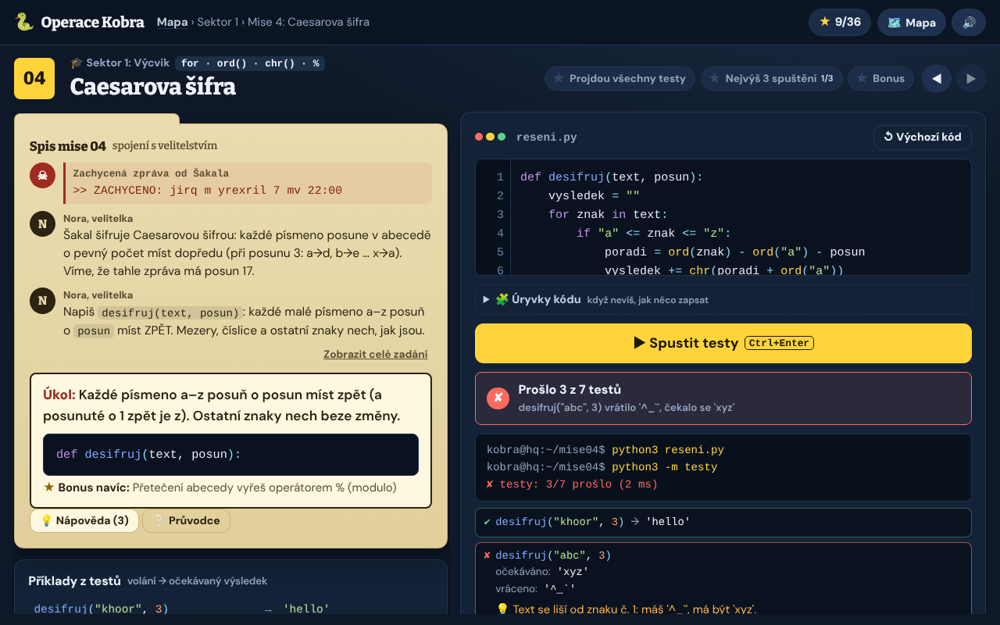
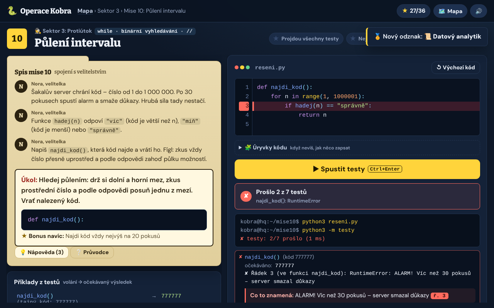
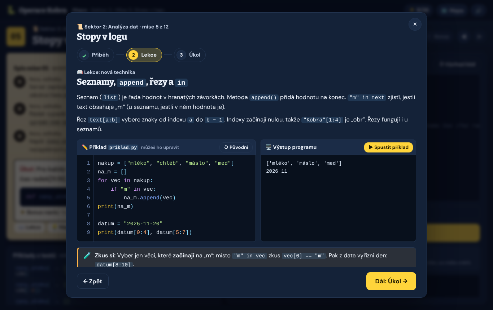
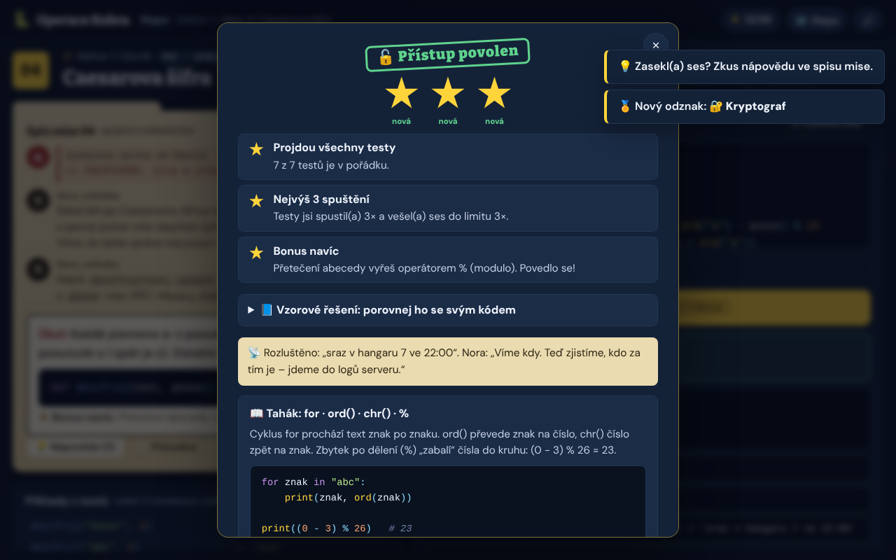
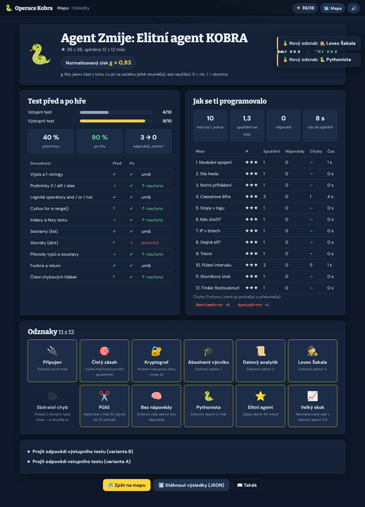

# 🐍 Operace Kobra

**Vzdělávací hra, ve které se Python učíš jako agent kybernetické jednotky.** Hackerská skupina Šakal útočí na město. Ty píšeš **skutečný Python** – dešifruješ zachycené zprávy, analyzuješ logy serveru, převádíš IP adresy na bity, otevřeš trezor hrubou silou, obejdeš alarm půlením intervalu, prolomíš databázi hesel a nakonec Šakala dopadneš.

- 🎮 **Hrát online:** https://UZIVATEL.github.io/operace-kobra/
- 💻 **Zdrojový kód:** https://github.com/UZIVATEL/operace-kobra

> Hra běží celá v prohlížeči – včetně Pythonu. Obsahuje vlastní interpret Pythonu napsaný v JavaScriptu, takže nepotřebuje server, instalaci ani internet (funguje i z `file://`).



---

## 🎯 Záměr

Začátečníci v Pythonu narážejí na tři věci: (1) nevědí, **k čemu** jim je cyklus nebo slovník, (2) chybové hlášky jsou **anglicky a strašidelně**, (3) když program „skoro funguje“, nevědí, **co přesně** je špatně.

Operace Kobra to řeší takhle:
- **Smysluplné úkoly z IT a kyberbezpečnosti.** Cyklus neprochází abstraktní seznam čísel, ale znaky zachycené zprávy. Slovník počítá neúspěšná přihlášení z IP adres. Bitové `&` rozhodne, jestli útočník opravdu patří do naší sítě. Hráč se mimochodem dozví, proč jsou 4místné PINy slabé, proč se hesla hashují a proč binární vyhledávání potřebuje jen 20 pokusů na milion možností.
- **Skutečné chyby Pythonu – s vysvětlením česky.** Terminál ukáže originální hlášku (stejný text jako CPython 3.13), označí řádek v editoru a pod ní vysvětlí, co znamená a jak ji opravit. Hráč se tak učí číst tracebacky, místo aby se jich bál.
- **Testy jako u profesionálů.** Každá mise je funkce, kterou ověří sada testů (viditelné příklady + skryté okrajové případy). Když test neprojde, hra řekne konkrétně proč: „Funkce nic nevrátila – výsledek jen vypsala pomocí print()“, „Text se liší od znaku č. 22“, „Čekám celé číslo, vrátil(a) jsi float – použij //“.

## 🕹️ Jak se hraje

1. **Vstupní test** – 10 otázek (asi 3 minuty).
2. **12 misí ve 3 sektorech** – spis mise s brífinkem od velitelky Nory a úkolem, příklady z testů, editor s rozbalovacími úryvky kódu. `Ctrl+Enter` spustí kód i testy.
3. **Výstupní test a výsledky** – porovnání před/po, dovednost po dovednosti.

| Sektor | Mise | Python | IT téma |
|---|---|---|---|
| 🎓 1 · Výcvik | 1 Navázání spojení · 2 Síla hesla · 3 Noční přihlášení · 4 Caesarova šifra | funkce a `return`, f-stringy, `if/elif/else`, `len()`, `and/or/not`, `for` přes text, `ord()/chr()`, `%` | bezpečná hesla, detekce podezřelého přihlášení, šifrování |
| 📜 2 · Analýza dat | 5 Stopy v logu · 6 Kdo útočí? · 7 IP v bitech · 8 Stejná síť? | seznamy, `append`, řezy `[a:b]`, slovníky a `get()`, `split()`, `sorted()`, `int()`, `format(n, "08b")`, `join()`, bitové `&`, `zip()/all()` | logy serveru, IP adresy, dvojková soustava, maska podsítě |
| 🕵️ 3 · Protiútok | 9 Trezor · 10 Půlení intervalu · 11 Slovníkový útok · 12 Finále | hrubá síla s `range()` a `zfill()`, `while` a binární vyhledávání, funkce volající funkce, skládání funkcí | síla PINu, omezení pokusů, hashování hesel, slovníkový útok, prolomení šifry |

V misích 9 a 10 hráč pracuje se **simulovaným zařízením** – funkcí `zamek(pin)` (trezor) a `hadej(n)` (server, který po 30 pokusech spustí alarm). Hra počítá pokusy, takže je vidět rozdíl mezi hrubou silou (až milion pokusů → ALARM) a půlením (20 pokusů).



### 📖 Příběh → Lekce → Úkol

Každá mise začíná ve třech krocích:

1. 💬 **Příběh**: o co jde a proč to postavy potřebují.
2. 📖 **Lekce**: nová věc vysvětlená na vlastním příkladu, který si můžeš hned upravit; příklad se spustí v Pythonu přímo ve hře a ukáže svůj výstup. U lekce je i „🧪 Zkus si“, „⚠️ Pozor“ na nejčastější chybu a zajímavost ze skutečného světa. Příklad je schválně jiný než úkol, takže lekce učí, ale neprozradí řešení.
3. 🎯 **Úkol**: co přesně udělat a za co dostaneš každou ze tří hvězd.

Lekci otevřeš kdykoli znovu tlačítkem **📖 Lekce** a v taháku (příručce) jsou lekce všech odemčených úrovní.



## 🎉 Proč je to zábavné

- **Příběh na pokračování** – každá splněná mise posune vyšetřování: rozluštěná zpráva prozradí čas srazu, logy ukážou útočníkovu IP, trezor vydá server, hash heslo… a finále rozluští Šakalovu poslední zprávu.
- **Atmosféra tajné služby** – zadání mise jako papírový spis, barvy z loga Pythonu, bootovací sekvence terminálu, „zachycené přenosy“ a razítko *🔓 Přístup povolen* po splnění mise.
- **Přehledná obrazovka mise.** Nahoře číslo a název mise s hvězdami, pod tím zadání, vlevo spis mise s příklady z testů a vpravo kód. Pod editorem je velké tlačítko ▶ Spustit testy a hned pod ním stavový řádek, který řekne, co se stalo a co opravit. Na velké obrazovce se celý mise vejde do okna bez posouvání.
- **Tři hvězdy za misi** – ★ za splnění, ★ za nejvýš 3 spuštění, ★ za bonusový úkol (např. „vyřeš to jedním list comprehension“, „najdi kód nejvýš na 20 pokusů“, „skonči hned, jak PIN najdeš“).
- **12 odznaků a hodnosti** (🥚 Nováček → 🐍 Elitní agent KOBRA), zvuky, konfety.
- **Férová pomoc** – tři nápovědy na misi, vzorové řešení až po opakovaném neúspěchu (a pak jen za 1 hvězdu), tahák se vším, co se hráč naučil.
- **Hráč vždycky ví, co se děje.** V první úrovni ho provede průvodce obrazovkou (zadání, editor, spuštění, výsledky, hvězdy) a tlačítkem ❔ Průvodce si ho pustí kdykoli znovu. Bonus je vidět hned pod zadáním. Po vyřešení hra u každé hvězdy napíše, za co ji dostal, a u chybějící vysvětlí, jak ji získat, i s ukázkou kódu. Vzorové řešení si pak může rozbalit a porovnat se svým.



## 📈 Měřitelnost pokroku

**1. Vstupní a výstupní test (paralelní formy A/B)**
- 10 otázek na 10 dovedností: výpis a f-stringy, podmínky, logické operátory, cyklus `for`, indexy a řezy, seznamy, slovníky, převody typů a soustavy, funkce a `return`, čtení chybových hlášek.
- Hráč náhodně dostane variantu A nebo B na začátek a tu druhou na konec – výsledek nezkreslí zapamatované otázky. Odpovědi se míchají, volba **🤷 Nevím** omezuje hádání.
- **Normalizovaný zisk** (Hake): `g = (po − před) / (1 − před)` a **tabulka dovedností před/po** (↑ naučeno / umíš / procvičit).

**2. Herní metriky (pro každou misi)**
- počet spuštění do splnění a splnění na první pokus,
- použité nápovědy a zobrazení řešení,
- **typy chyb Pythonu**, na které hráč narazil (TypeError, IndentationError, NameError…) – a že je dokázal překonat,
- počet prošlých testů, splněné bonusy (kvalita řešení), čas do splnění,
- u zařízení počet pokusů (efektivita algoritmu).

**3. Export** – *Stáhnout výsledky (JSON)* uloží testy a odpovědi, dovednosti, statistiky misí, typy chyb, odznaky a log událostí (spuštění, nápovědy, splnění).



## ⚙️ Jak to funguje technicky

- **Vlastní interpret Pythonu (`js/python.js`).** Lexer s odsazováním (INDENT/DEDENT), parser do AST a interpret, který umí: `int` libovolné velikosti (BigInt), `float`, `bool`, `None`, `str`, `list`, `tuple`, `dict`, `set`, `range`; f-stringy a `format()` (zarovnání, nuly, `08b`, `.2f`, `%`…); `def` s výchozími a pojmenovanými argumenty, `*args`, vnořené funkce a closures, `global`/`nonlocal`, rekurzi; `lambda`; `if/elif/else`, `while`, `for` s rozbalováním, `break/continue`; `try/except/else/finally`, `raise`, `assert`; list/dict/set comprehensions a generátorové výrazy; řezy, řetězené porovnání, bitové operace; desítky vestavěných funkcí a metod; moduly `math`, `string`, `random`.
- **Chyby jako v CPythonu.** Stejné texty chyb (včetně „Did you mean…?“ podle stejného algoritmu jako CPython), číslo řádku a funkce, plus české vysvětlení.
- **Bezpečné spouštění.** Omezený počet kroků (nekonečný cyklus nezasekne prohlížeč), omezená hloubka rekurze a velikost výstupu.
- **Testovací rozhraní (`js/harness.js`).** Spustí kód hráče, zavolá funkci s testovacími vstupy, porovná výsledek přísně (typ i hodnota) se vzorovým řešením a vysvětlí rozdíl. Bonusové cíle se ověřují nad AST hráčova kódu (např. jestli použil f-string nebo list comprehension).
- **Bez závislostí.** Čisté HTML/CSS/JS, `localStorage`, Web Audio, responzivní rozvržení.

## 🧪 Testy

`tests/test.html` (otevři v prohlížeči) – **216 kontrol**:
- **69 programů** porovnaných se skutečným **CPythonem 3.13** – výstup musí sedět znak po znaku a chybové hlášky slovo po slovu (aritmetika s velkými čísly, zaokrouhlování, formátování floatů, f-stringy, řezy, slovníky, výjimky, chyby syntaxe a odsazení…),
- každá mise: vzorové řešení projde všemi testy, bonus jde splnit, výchozí kód je spustitelný, ale neprojde, a typické chyby začátečníků (např. `str + int`, `print` místo `return`, `<=` místo `<`, chybějící `zfill`, prohozené meze v půlení) neprojdou.

Očekávané hodnoty všech testů misí byly navíc ověřeny v CPythonu.
- **lekce**: každá úroveň má úplnou lekci (výklad, příklad, „Zkus si“, „Pozor“), příklad je platný kód, který jde spustit nebo vykreslit, a neprozradí řešení úrovně (jiné prvky a funkce, žádné opsané řádky).

## ▶️ Spuštění

- **Nejjednodušší:** otevři `index.html` v prohlížeči.
- **VS Code:** otevři složku a spusť přes *Run and Debug* (F5), nebo použij rozšíření *Live Server*.

### Nasazení na GitHub Pages

1. Vytvoř na GitHubu veřejný repozitář `operace-kobra` a nahraj do něj obsah této složky (`index.html` v kořeni).
2. **Settings → Pages → Build and deployment → Source: Deploy from a branch**, větev `main`, složka `/ (root)` → **Save**.
3. Za minutu je hra na `https://UZIVATEL.github.io/operace-kobra/`. Odkazy nahoře v README přepiš na skutečné.

## 📁 Struktura

```
operace-kobra/
├── index.html              – kostra aplikace
├── css/base.css            – společná kostra obrazovek (lišta, kvíz, mapa, mise, výsledky)
├── css/style.css           – vzhled (spis tajné služby, barvy Pythonu)
├── fonts/                  – písma DM Sans a Bitter (licence SIL OFL)
├── js/kit.js               – úložiště, zvuky, okna, kvíz, export
├── js/editor.js            – editor kódu se zvýrazněním Pythonu
├── js/python.js            – interpret Pythonu (lexer, parser, interpret, chyby česky)
├── js/missions.js          – 12 misí, data, testy, nápovědy, kvíz A/B
├── js/harness.js           – testování funkcí hráče, simulovaná zařízení
├── js/lessons.js           – lekce ke každé úrovni: výklad, příklad, zkus si, pozor
├── js/lesson.js            – společný úvod úrovně (Příběh → Lekce → Úkol) a živé příklady
├── js/app.js               – obrazovky, hvězdy, odznaky, měření, výsledky
├── tests/test.html         – automatické testy (vs. CPython + mise)
├── tests/lessons-check.js  – kontrola lekcí (úplnost, platný kód, neprozradí řešení)
├── tests/cpython-expected.js – výstupy CPythonu pro porovnání
└── screenshots/            – obrázky do README
```

---

Vytvořeno jako semestrální projekt **4ITE PHR – EduGame**. Postavy, skupina Šakal i všechna data (logy, IP adresy, hesla) jsou smyšlené; útoky v misích probíhají jen proti simulovaným zařízením ve hře.
