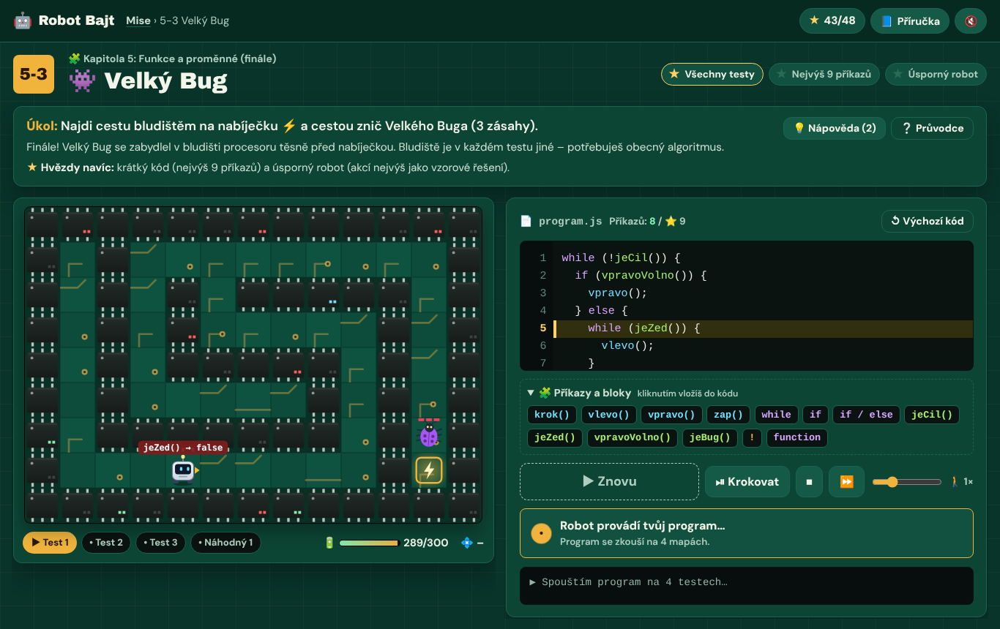
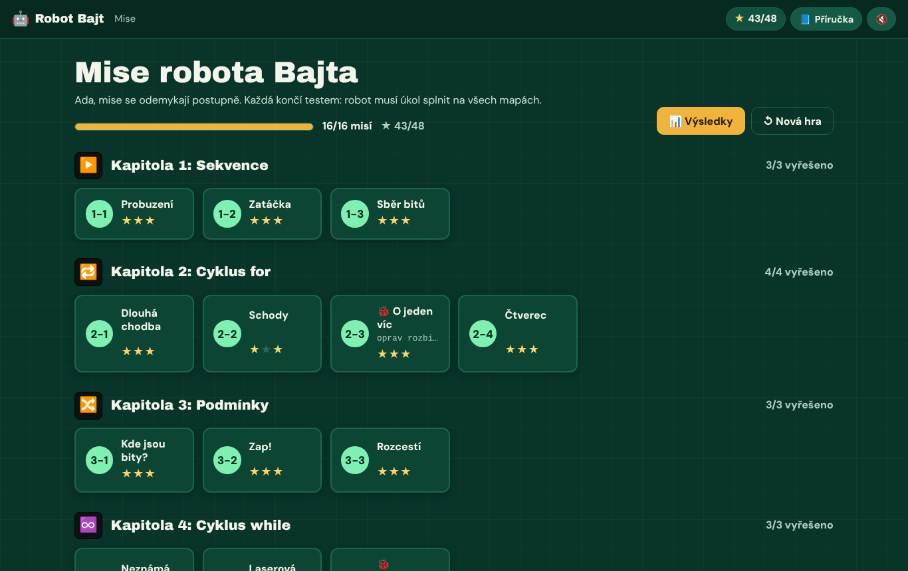
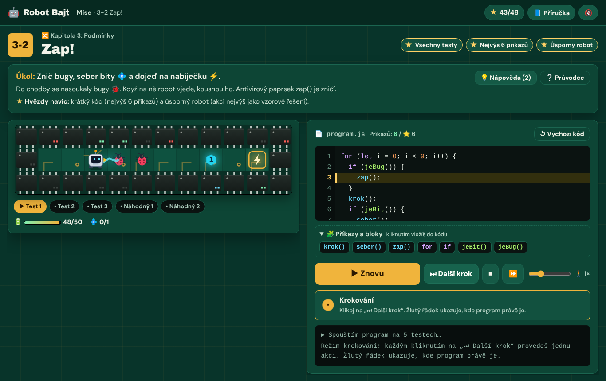
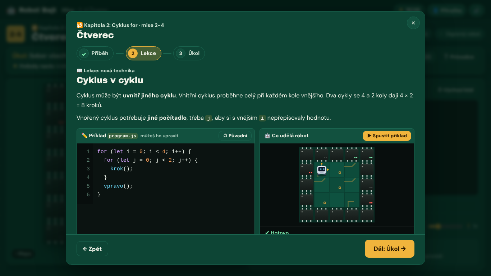
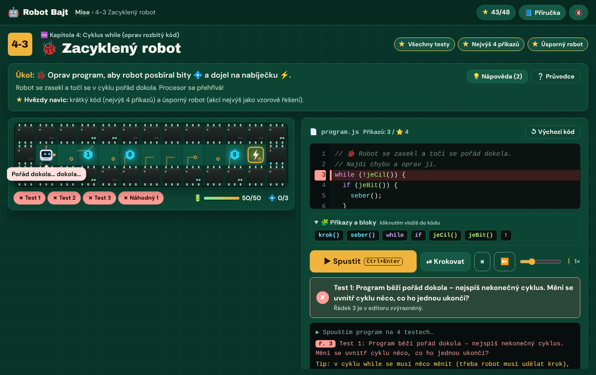
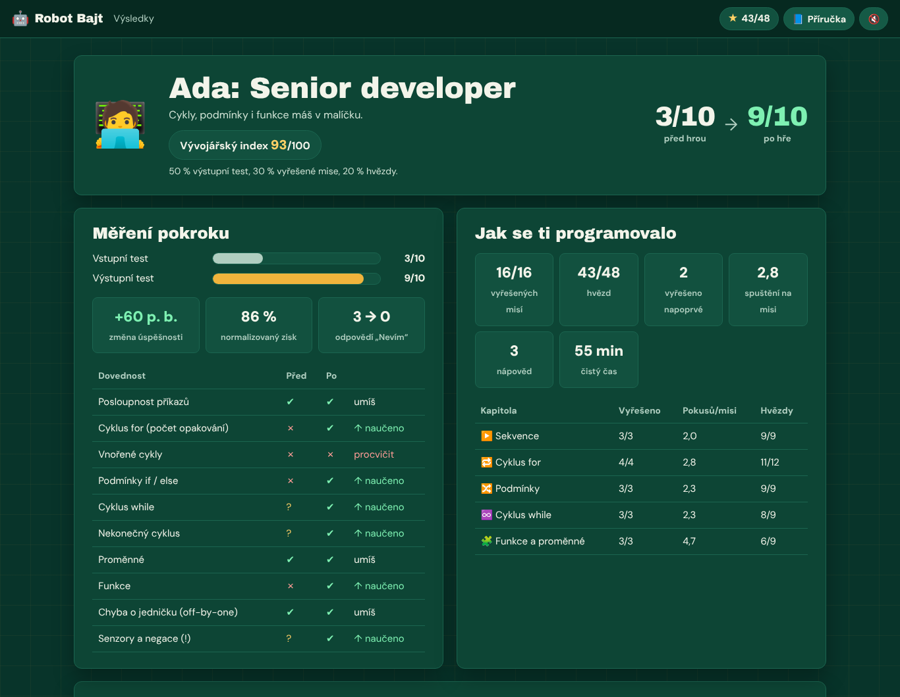

# 🤖 Robot Bajt

**Naučná programovací hra: píšeš skutečný JavaScript a robot Bajt ho na obrazovce provádí.** Hráč se učí základy programování (posloupnost příkazů, cykly `for` a `while`, podmínky, funkce, proměnné) a hlavně **ladění**: robot narazí do zdi, spálí se v laseru nebo se zacyklí, a hráč musí zjistit proč. Pokrok se měří vstupním a výstupním testem.

- 🕹️ **Hrát online:** https://UZIVATEL.github.io/robot-bajt/
- 💻 **Zdrojový kód:** https://github.com/UZIVATEL/robot-bajt

> Projekt do předmětu **4ITE PHR – EduGame**. Technologie: čisté **HTML + CSS + JavaScript** bez knihoven, bez serveru a bez sestavování. Hra obsahuje vlastní interpret podmnožiny JavaScriptu.



---

## 1. Záměr: co a proč chci vysvětlit

**Problematika: základy programování a algoritmického myšlení.** Programování je základ celého oboru IT, ale začátečníci se v něm často ztrácejí ve dvou věcech:

1. **Abstrakce:** co přesně dělá cyklus, proč se podmínka vyhodnotí jinak, než čekám, a jak se z „kroku vpřed“ stane obecný algoritmus.
2. **Chyby:** program nefunguje, a nováček neví proč. Klasická výuka ukazuje hotový správný kód, ne cestu k němu přes chyby.

**Řešení: kód, který je vidět.** V Robotu Bajtovi hráč píše skutečný kód a hned vidí, co program dělá. Robot jede po mapě a v editoru svítí řádek, který se právě provádí. U senzorů se ukáže, co vrátily (`jeZed() → false`). Abstraktní pojmy se tak stávají viditelným pohybem robota a chyba je vidět dřív, než ji hráč pochopí.

**Cílová skupina:** úplní začátečníci (žáci ZŠ a SŠ, první ročník VŠ, rekvalifikace), kteří nikdy neprogramovali nebo jen zkoušeli bloky typu Scratch. Pokročilejší hráči si užijí hvězdy za co nejkratší kód a finální bludiště.

**Proč skutečný JavaScript, a ne bloky:** syntaxe ve hře je **podmnožina skutečného JavaScriptu** (`let`, `if`/`else`, `for`, `while`, `function`, `return`, `++`, `&&`, `!`…). Co se hráč naučí, platí i mimo hru. Příkazy robota jsou obyčejné funkce, například `krok();`.

### Výukové cíle

Po dohrání by hráč měl umět:

1. Napsat **posloupnost příkazů** a předpovědět, co program udělá.
2. Použít **cyklus `for`** se správným počtem opakování a vyhnout se chybě „o jedničku“ (*off-by-one*).
3. Použít **vnořené cykly** pro opakované vzory.
4. Rozhodovat se pomocí **podmínek `if` / `else`** podle hodnot senzorů (`true` / `false`).
5. Použít **cyklus `while`**, když předem neví počet opakování, a rozpoznat **nekonečný cyklus**.
6. Napsat a zavolat **vlastní funkci** a pracovat s **proměnnou** (počítadlo).
7. Psát **obecný algoritmus**, který projde **několika testy** s různými mapami, ne jen jednou konkrétní mapou (princip unit testů).
8. **Ladit:** číst chybové hlášky, krokovat program a opravit cizí rozbitý kód.

---

## 2. Jak se hraje

```
📝 Vstupní test  →  🤖 16 misí v 5 kapitolách  →  🎓 Výstupní test  →  📊 Výsledky
   (10 otázek)        (píšeš kód, robot jede)        (10 jiných otázek)
```

| Kapitola | Koncept | Mise |
|---|---|---|
| ▶️ 1. Sekvence | posloupnost příkazů | Probuzení · Zatáčka · Sběr bitů |
| 🔁 2. Cyklus for | opakování, off-by-one, vnořené cykly | Dlouhá chodba · Schody · 🐞 O jeden víc · Čtverec |
| 🔀 3. Podmínky | `if` / `else`, senzory, **testy na náhodných mapách** | Kde jsou bity? · Zap! · Rozcestí |
| ♾️ 4. Cyklus while | neznámý počet opakování, nekonečný cyklus | Neznámá délka · Laserová brána · 🐞 Zacyklený robot |
| 🧩 5. Funkce a proměnné | vlastní funkce, počítadlo, obecný algoritmus | Vlastní příkaz · Inventura · 👾 Velký Bug (bludiště) |



Každá mise má krátký příběh, úkol a tři hvězdy:

- ⭐ **Splň úkol**, a to ve všech testech.
- ⭐ **Krátký kód:** nejvýš *N* příkazů, takže se vyplatí cykly a funkce.
- ⭐ **Úsporný robot:** robot neudělá víc akcí než vzorové řešení.

**Ovládání:** kód píšeš do editoru, nebo klikáš na příkazy v pruhu *Příkazy a bloky* pod editorem (funguje i na mobilu).

**Obrazovka mise:** nahoře číslo a název mise s hvězdami, pod tím úkol, vlevo deska s robotem a vpravo kód. Pod editorem je velké tlačítko **▶ Spustit** a hned pod ním stavový řádek, který řekne, co se stalo (např. *Test 1: Tady žádný bit není*) a který řádek opravit. Na velké obrazovce se celá mise vejde do okna bez posouvání.

| Tlačítko | Co dělá |
|---|---|
| **▶ Spustit** (`Ctrl` + `Enter`) | spustí program na všech testech a přehraje animaci |
| **⏯ Krokovat** | provádí program po jedné akci; žlutý řádek ukazuje, kde program je |
| **⏹** / **⏩** | zastaví program / přeskočí animaci rovnou na výsledek |
| posuvník | rychlost animace 0,5× až 10× |
| 💡 Nápověda | dvě postupné nápovědy pro každou misi |
| 📘 Příručka | příkazy robota a ukázky syntaxe (během testu je zavřená) |

### Příkazy robota

| Akce (stojí energii) | Senzory (vrací `true` / `false`) |
|---|---|
| `krok()` – krok dopředu | `jeZed()` – je přede mnou zeď? |
| `vlevo()` / `vpravo()` – otočení o 90° | `jeVolno()`, `vlevoVolno()`, `vpravoVolno()` |
| `seber()` – sebere bit | `jeBit()` – leží tu bit? |
| `zap()` – vystřelí po bugu | `jeBug()` – je přede mnou bug? |
| `cekej()` – počká jeden takt | `laser()` – je přede mnou zapnutý laser? |
| `ohlas(x)` – řekne hodnotu | `jeCil()` – stojím v cíli? |



---

### 📖 Příběh → Lekce → Úkol

Každá mise začíná ve třech krocích:

1. 💬 **Příběh**: o co jde a proč to postavy potřebují.
2. 📖 **Lekce**: nová věc vysvětlená na vlastním příkladu, který si můžeš hned upravit; robot příklad předvede na malé ukázkové mapě. U lekce je i „🧪 Zkus si“, „⚠️ Pozor“ na nejčastější chybu a zajímavost ze skutečného světa. Příklad je schválně jiný než úkol, takže lekce učí, ale neprozradí řešení.
3. 🎯 **Úkol**: co přesně udělat a za co dostaneš každou ze tří hvězd.

Lekci otevřeš kdykoli znovu tlačítkem **📖 Lekce** a v taháku (příručce) jsou lekce všech odemčených úrovní.



## 3. Proč je to zábavné (herní design)

| Prvek | Proč funguje |
|---|---|
| **Robot s osobností** | Bajt mrká, při nárazu se mu „zatočí hlava“, mluví v bublinách („Au! Zeď.“, „Točí se mi hlava… 😵“). Chyba je vtipná, ne frustrující. |
| **Okamžitá vizuální zpětná vazba** | Kód se změní v pohyb, sbírání bitů s efekty, výbuchy bugů a zvuky. Rychlost se dá zrychlit až na 10×. |
| **Krokování jako v pravém debuggeru** | Hráč prochází program akci po akci, vidí aktivní řádek a hodnoty senzorů. Ladění se tak samo stává herní mechanikou. |
| **Testy jako v praxi** | Od 3. kapitoly se program spouští na více mapách, včetně **náhodných při každém spuštění**. Natvrdo napsaná cesta neprojde, a hráč objeví smysl obecného algoritmu. Zelené a červené štítky testů dávají uspokojení. |
| **🐞 Debug mise** | Dvě mise začínají rozbitým programem kolegy (chyba „o jedničku“, nekonečný cyklus). Hledat cizí chybu je detektivka. |
| **Hvězdy za krátký kód** | „Code golf“: jde to napsat na 2 příkazy? Motivuje přepsat funkční řešení elegantněji pomocí cyklů a funkcí. |
| **Rostoucí výzva a boss** | Od chodby přes lasery s časováním až po náhodné bludiště s Velkým Bugem, kterého je potřeba třikrát zasáhnout. |
| **Odznaky** | Hello, world!, Cyklista, Debugger, Golfista, Perfekcionista, Lovec bugů… Jeden je i za nekonečný cyklus: „Nekonečno a ještě dál“. |
| **Přátelské chybové hlášky** | Česky, s číslem řádku a návrhem opravy: „Neznámý příkaz `krk()`. Nemyslel(a) jsi `krok()`?“, „V podmínce je `=` (přiřazení). Pro porovnání použij `===`.“ |
| **Nic se neztratí** | Kód každé mise i postup se ukládají. Když se hráč zasekne, může misi po 6 pokusech přeskočit. |
| **Hráč vždycky ví, co se děje** | V první misi ho provede průvodce obrazovkou (úkol, svět, editor, spuštění, konzole, hvězdy) a tlačítkem ❔ Průvodce si ho pustí znovu. Hvězdy navíc jsou vidět hned pod úkolem. Po misi hra u každé hvězdy napíše, za co ji dostal, a u chybějící vysvětlí, jak ji získat, i se vzorovým řešením. |



---

## 4. Měřitelnost dosaženého pokroku

Hra kombinuje **test před hrou a po ní** (pre-test / post-test) s **daty o tom, jak hráč programuje**.

### 4.1 Vstupní a výstupní test

- **10 otázek na čtení kódu**, jedna na každý koncept (viz tabulka). Hráč předpovídá, co kód udělá, kolikrát se cyklus provede, který program se nezastaví, který `for` udělá přesně 5 kroků…
- Existují **dvě rovnocenné sady A a B**. Mají stejné koncepty ve stejném pořadí, ale jiná čísla a jiný kód. **Která sada bude vstupní, se losuje**, a výstupní test je vždy ta druhá. Hráč tak nedostane stejné otázky dvakrát a rozdíl nezpůsobuje obtížnost sady. **Pořadí odpovědí se míchá.**
- U každé otázky je možnost **„🤷 Nevím“**, aby hráč nemusel tipovat. Počet odpovědí „Nevím“ je sám o sobě měřítko jistoty.
- Testy jsou **bez nápovědy a bez příručky**.
- Správnost všech odpovědí je **ověřená automaticky**: testovací skript spustí kód z otázek ve stejném interpretu, který používá hra.

| Koncept | Příklad otázky |
|---|---|
| Posloupnost příkazů | Kde robot skončí po `krok(); vpravo(); krok(); krok();`? |
| Cyklus for | Kolik kroků udělá `for (let i = 0; i < 4; i++) { krok(); krok(); }`? |
| Vnořené cykly | Kolikrát se zavolá `seber()` ve dvou vnořených cyklech? |
| Podmínky | Co robot ohlásí po `if (x > 5) … else …`? |
| Cyklus while | Jakou hodnotu má `n` po cyklu `while (n > 0) { n = n - 4; }`? |
| Nekonečný cyklus | Který ze čtyř programů se nikdy nezastaví? |
| Proměnné | Jaký je součet v proměnné po cyklu? |
| Funkce | Kolik kroků udělá program, který dvakrát volá vlastní funkci? |
| Off-by-one | Který `for` udělá *přesně* 5 kroků? |
| Senzory a negace | Co dělá `while (!jeZed()) { krok(); }`? |

### 4.2 Sledované metriky

| Metrika | Jak se počítá | Co říká |
|---|---|---|
| **Úspěšnost testů** | správně / 10, před hrou a po ní | výchozí a konečná úroveň |
| **Změna úspěšnosti** | post − pre (procentní body) | absolutní zlepšení |
| **Normalizovaný zisk** (Hake) | `g = (post − pre) / (1 − pre)` | jakou část *možného* zlepšení hráč získal; < 0,3 nízký, 0,3–0,7 střední, > 0,7 vysoký |
| **Dovednosti před a po** | správnost pro každý z 10 konceptů | *které* koncepty se hráč naučil („↑ naučeno“) a které má ještě procvičit |
| **Odpovědi „Nevím“** | počet před hrou a po ní | jistota hráče |
| **Vyřešené mise a hvězdy** | 16 misí, 48 hvězd | jak daleko hráč došel a jak elegantní kód píše |
| **Spuštění do vyřešení** | počet běhů programu, než mise prošla; průměr po kapitolách | jak náročná která kapitola byla |
| **Vyřešeno napoprvé** | mise splněné prvním spuštěním | plynulost |
| **Typy chyb** | syntaxe, náraz do zdi, nekonečný cyklus, laser, bug, došlá baterka, nesplněný úkol… | *jak* hráč chyboval a ladil |
| **Použité konstrukce** | `for`, `while`, `if`, `else`, senzory, `!`, proměnné, funkce (analýza kódu z AST) | zda hráč nové koncepty opravdu používá ve vlastním kódu |
| **Nápovědy a čas** | počet otevřených nápověd, čistý čas v misích | samostatnost |
| **Vývojářský index** | `0,5 × výstupní test + 0,3 × vyřešené mise + 0,2 × hvězdy` | souhrnné skóre 0–100 → úroveň od 🐣 *Stážisty* po 🏆 *Hacker legendu* |



### 4.3 Historie a export dat

- Každý dohraný průchod se uloží do **historie v prohlížeči** (`localStorage`).
- Tlačítko **„Stáhnout data (JSON)“** vyexportuje všechno: každou odpověď v testech (koncept, správnost, „Nevím“, čas), statistiky každé mise (počet spuštění, typy chyb, hvězdy, nejkratší kód, použité konstrukce, čas, nápovědy) i **finální kód hráče**. Vyučující tak může posbírat data celé třídy a vyhodnotit je, nebo si přečíst, jak kdo úlohu vyřešil.

### 4.4 Omezení měření

Deset otázek dává hrubší měřítko (jedna otázka na koncept). Pro spolehlivé závěry je lepší sbírat exporty od více hráčů a porovnávat průměry. Na výstupní test se dá jít už po vyřešení 12 misí, takže kdo nedohraje kapitolu 5, odpovídá na otázky o funkcích a proměnných bez výcviku. V exportu je vidět, které mise kdo vyřešil, takže se to dá při vyhodnocení zohlednit.

---

## 5. Technické řešení

- **Vlastní interpret JavaScriptu (bez `eval`).** `js/lang.js` obsahuje tokenizer, parser do AST a interpret, který prochází strom. Výhody oproti spuštění kódu přes `eval`:
  - **ochrana před nekonečným cyklem** (počítadlo operací) a nekonečnou rekurzí, takže se prohlížeč nikdy nezasekne,
  - **české chybové hlášky** s číslem řádku a návrhem opravy (Levenshteinova vzdálenost: `krk` → `krok`, `čekej` → `cekej`),
  - **statická kontrola** před spuštěním (neznámý příkaz, chybějící závorky, `=` v podmínce, `break` mimo cyklus…),
  - **analýza kódu**: počet příkazů pro hvězdu a které konstrukce hráč použil.
- **Svět robota je oddělený od grafiky.** `js/world.js` simuluje mapu, senzory, energii, lasery a bugy a vytváří záznam událostí. `js/render.js` ho přehrává jako animaci na `<canvas>`. Díky tomu jde stejný běh přehrát, krokovat i testovat bez grafiky.
- **Testy na náhodných mapách.** Generátory map používají deterministický generátor náhodných čísel (*mulberry32*), takže stejné semínko dá stejnou mapu. Pevné testy jsou vždy stejné, náhodné se mění při každém spuštění. Počet akcí pro hvězdu „úsporný robot“ se počítá spuštěním vzorového řešení na dané mapě. Bludiště se generuje algoritmem *recursive backtracker*.
- **Editor kódu.** Je to `textarea` nad zvýrazněným `<pre>`: barevná syntaxe, čísla řádků, zvýraznění právě prováděného a chybného řádku, automatické odsazení a `Tab`. Ctrl + Z funguje.
- **Automatické testy** (`node tests/run-tests.js`, bez závislostí):
  - každé vzorové řešení projde všemi testy (u misí s náhodnými mapami **303 různými mapami**) a splní hvězdu za krátký kód,
  - výchozí rozbitý kód úkol nesplní,
  - naivní řešení (pevný počet kroků, `if` místo `while`…) neprojdou,
  - správné odpovědi kvízu odpovídají skutečnému běhu kódu,
  - typické chyby dostanou srozumitelnou hlášku,
  - každá mise má úplnou lekci a robot její příklad na ukázkové mapě opravdu předvede (chybu ukáže jen tam, kde ji lekce schválně předvádí: chyba o jedničku a nekonečný cyklus).
- Hra je **responzivní** (na mobilu se kód skládá klepáním na paletu), respektuje `prefers-reduced-motion`, zvuky generuje Web Audio API a postup ukládá do `localStorage`.

### Struktura projektu

```
robot-bajt/
├── index.html          # stránka hry
├── css/base.css        # společná kostra obrazovek (lišta, kvíz, mapa, obrazovka mise, výsledky)
├── css/style.css       # vzhled „deska plošných spojů“ (zelená, měď, čipy)
├── fonts/              # písma DM Sans a Archivo Black (licence SIL OFL)
├── js/lang.js          # interpret podmnožiny JavaScriptu (tokenizer, parser, interpret, chyby)
├── js/world.js         # svět robota, senzory, energie, spouštění testů
├── js/levels.js        # obsah: 5 kapitol, 16 misí, generátory map, testy A/B, příručka
├── js/lessons.js       # lekce ke každé misi: výklad, příklad s ukázkovou mapou, zkus si, pozor
├── js/lesson.js        # společný úvod mise (Příběh → Lekce → Úkol) a živé příklady
├── js/render.js        # kreslení na canvas a přehrávání animace (robot, bity, lasery, bugy)
├── js/editor.js        # editor kódu se zvýrazněním syntaxe
├── js/app.js           # obrazovky, průběh hry, hvězdy, odznaky, měření, export
├── tests/run-tests.js  # automatické testy (node tests/run-tests.js)
├── screenshots/        # obrázky pro README
└── README.md
```

---

## 6. Spuštění a nasazení

**Lokálně:** stačí otevřít `index.html` v prohlížeči. Ve VS Code jde hru spustit přes `F5` nebo rozšířením Live Server.

**Testy:**

```bash
node tests/run-tests.js
```

**GitHub Pages:**

1. Na GitHubu vytvořit **veřejný** repozitář `robot-bajt` a nahrát do něj obsah složky.
2. V repozitáři otevřít **Settings → Pages** (sekce *Code and automation*).
3. V části **Build and deployment** zvolit *Source:* **Deploy from a branch**, *Branch:* **main** a složku **/ (root)**, pak kliknout na **Save**.
4. Asi za minutu běží hra na `https://UZIVATEL.github.io/robot-bajt/`.

```bash
git init
git add .
git commit -m "Robot Bajt – naučná programovací hra"
git branch -M main
git remote add origin https://github.com/UZIVATEL/robot-bajt.git
git push -u origin main
```

---

## Autor

**Jméno Příjmení**, předmět 4ITE PHR (EduGame), 2026
