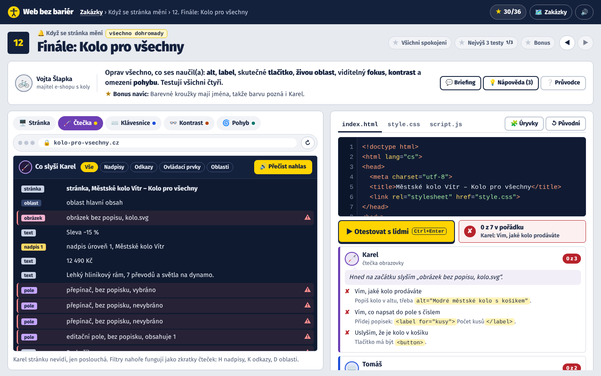
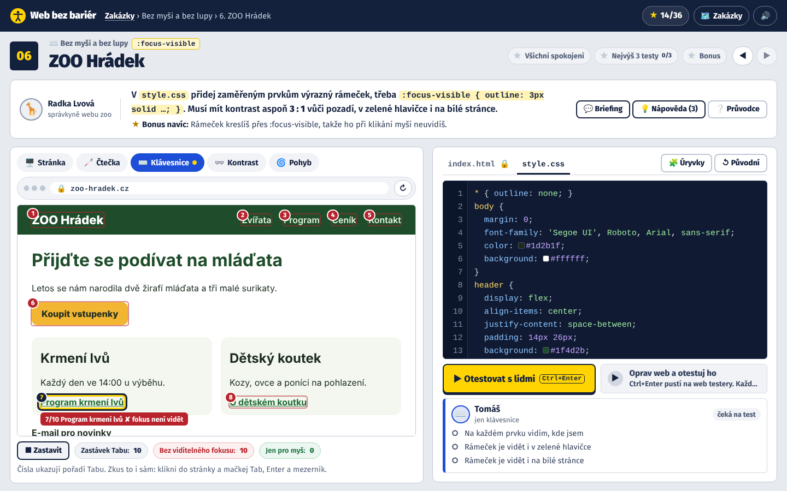
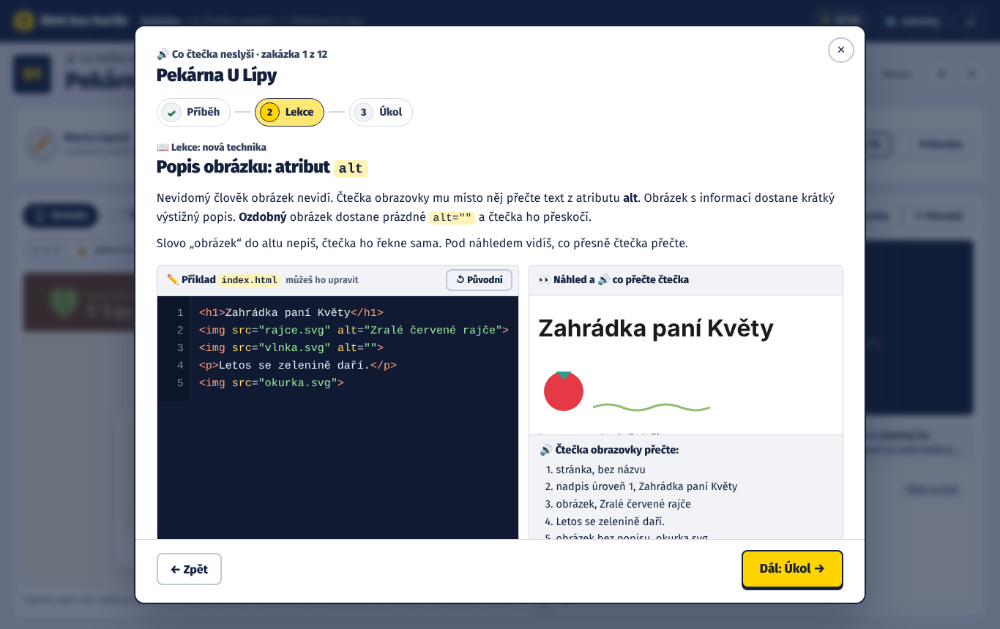
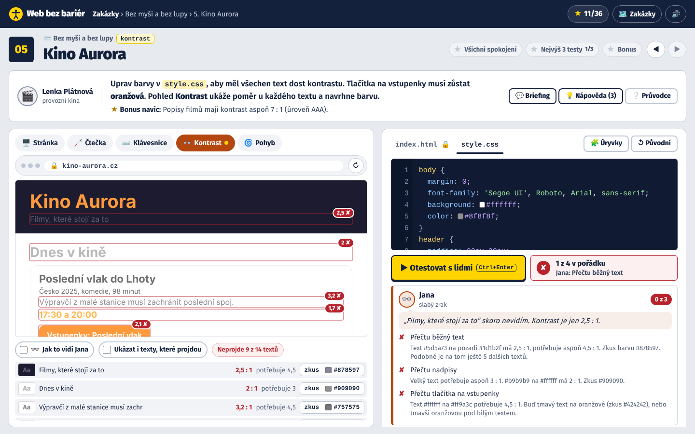
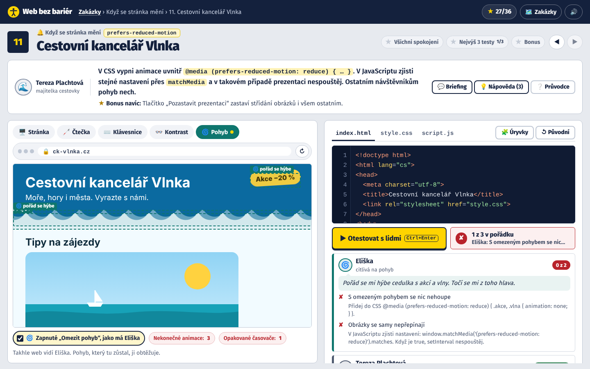
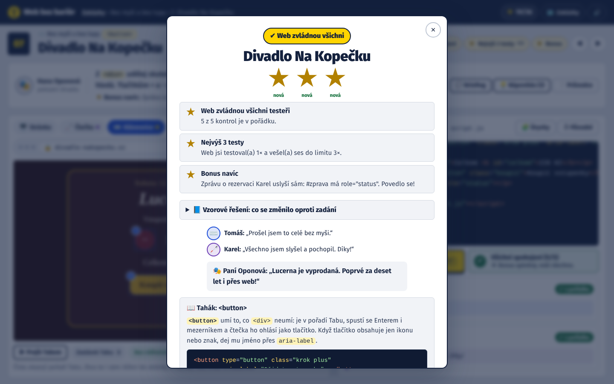

# ♿ Web bez bariér

**Vzdělávací hra, ve které opravuješ weby pro skutečné lidi.** Nastupuješ do malého studia, které dělá zakázky pro pekárnu, knihovnu, kino, divadlo nebo obecní úřad. Weby vypadají hezky, jenže je nezvládnou čtyři testeři: **Karel** se čtečkou obrazovky, **Tomáš**, který ovládá počítač jen klávesnicí, slabozraká **Jana** a **Eliška**, které se z pohybu na obrazovce dělá zle. Opravuješ **HTML, CSS a JavaScript** a testeři web hned vyzkouší a řeknou ti vlastními slovy, kde se zasekli.

- 🎮 **Hrát online:** https://UZIVATEL.github.io/web-bez-barier/
- 💻 **Zdrojový kód:** https://github.com/UZIVATEL/web-bez-barier

> Hra běží celá v prohlížeči, bez serveru a bez instalace (funguje i z `file://`). Web klienta se sestaví z tvého kódu a testuje se ve skutečném prohlížeči: jak ho přečte čtečka, kudy vede Tab, jaký má text kontrast a co se hýbe.



---

## 🎯 Záměr

Přístupnost webu (accessibility, a11y) se ve výuce programování často přeskočí, protože „u mě to funguje“. Vývojář vidí, má myš a dobrý zrak, takže chyby, které jiné lidi úplně zastaví, vůbec nezaznamená. Od 28. června 2025 přitom platí zákon č. 424/2023 Sb. (český převod Evropského aktu o přístupnosti), který přístupnost vyžaduje třeba u e-shopů.

Web bez bariér ukazuje web očima a ušima lidí, kteří ho používají jinak:
- **Čtyři testeři místo abstraktních pravidel.** Každý má jméno, věk a důvod, proč web používá jinak. Pravidla WCAG se tak mění v konkrétní zážitky: „U pečiva slyším jen *obrázek bez popisu, chleba.svg*.“
- **Pohledy testerů nad stránkou.** *Čtečka* vypíše, co přesně uslyší Karel (a umí to i přečíst nahlas). *Klávesnice* očísluje zastávky Tabu, označí prvky „jen pro myš“ a projde stránku Tabem. *Kontrast* změří poměr u každého textu a navrhne barvu. *Pohyb* ukáže, co se hýbe, když má návštěvník zapnuté „Omezit pohyb“.
- **Skutečný kód, skutečná měření.** Hráč píše normální HTML, CSS a JavaScript. Auditor ve hře počítá přístupná jména prvků, role, pořadí Tabu, kontrast podle WCAG 2 a viditelnost fokusu přímo z vykreslené stránky. Testy proto projde jakékoli správné řešení, ne jen jedno vzorové.
- **Přístupnost i vzhled.** Klient má vždy svoje přání (oranžové tlačítko, stejný vzhled nadpisů, animace pro ostatní). Hráč se učí, že přístupný web nemusí být ošklivý.

## 🕹️ Jak se hraje

1. **Vstupní test**: 10 otázek, asi 3 minuty.
2. **12 zakázek ve 3 kapitolách**: briefing s klientem a testery, zadání, prohlížeč s pěti pohledy, editor souborů `index.html`, `style.css` a `script.js` s úryvky kódu. Tlačítko **Otestovat s lidmi** (`Ctrl+Enter`) pustí na web všechny testery.
3. **Výstupní test a výsledky**: porovnání před/po, dovednost po dovednosti.

| Kapitola | Zakázky | Co se opravuje | Testují |
|---|---|---|---|
| 🔊 1 Co čtečka neslyší (HTML) | 1 Pekárna U Lípy, 2 Městská knihovna, 3 Keramická dílna, 4 Turistický klub | `alt` a ozdobné obrázky, nadpisy `h1`–`h3` a `lang`, `<label>`, `required`, `fieldset`/`legend`, srozumitelné odkazy a `aria-label` u ikony | Karel, Jana |
| ⌨️ 2 Bez myši a bez lupy (CSS + klávesnice) | 5 Kino Aurora, 6 ZOO Hrádek, 7 Divadlo Na Kopečku, 8 Obecní úřad Lhota | kontrast textu (AA i AAA), `:focus-visible` s kontrastem rámečku, `<button>` místo `<div>`, odkaz „Přeskočit na obsah“ a oblasti `header`/`nav`/`main`/`footer` | Jana, Tomáš, Karel |
| 🔔 3 Když se stránka mění (JS + ARIA) | 9 Půlmaraton, 10 Kavárna Pod Věží, 11 Cestovní kancelář Vlnka, 12 Finále: Kolo pro všechny | `role="alert"`/`role="status"`, `aria-invalid`, `aria-describedby`, přesun fokusu, `aria-expanded`, `aria-hidden`, `prefers-reduced-motion` v CSS i `matchMedia` v JS, tlačítko pro zastavení pohybu | všichni čtyři |



### 📖 Příběh → Lekce → Úkol

Každá zakázka začíná ve třech krocích:

1. 💬 **Příběh**: o co jde a proč to postavy potřebují.
2. 📖 **Lekce**: nová věc vysvětlená na vlastním příkladu, který si můžeš hned upravit; pod živým náhledem příkladu je vidět, co z něj přečte čtečka obrazovky. U lekce je i „🧪 Zkus si“, „⚠️ Pozor“ na nejčastější chybu a zajímavost ze skutečného světa. Příklad je schválně jiný než úkol, takže lekce učí, ale neprozradí řešení.
3. 🎯 **Úkol**: co přesně udělat a za co dostaneš každou ze tří hvězd.

Lekci otevřeš kdykoli znovu tlačítkem **📖 Lekce** a v taháku (příručce) jsou lekce všech odemčených úrovní.



## 🎉 Proč je to zábavné

- **Testeři mluví.** Po každém testu dostaneš od Karla, Tomáše, Jany nebo Elišky větu v první osobě („Zmáčkl jsem Enter na +, a počet je pořád 1.“) a pod ní konkrétní radu. Klient se ozve, když oprava rozbije jeho design.
- **Hra tě nechá zažít, co testeři zažívají.** Stránku si poslechneš hlasem čtečky (i to, jak zní čeština přečtená anglickým hlasem, když chybí `lang`). Projdeš ji Tabem a uvidíš, kde fokus „zmizí“. Zapneš si filtr „Jak to vidí Jana“. Do živého náhledu můžeš klikat a sám/sama mačkat Tab.
- **Dvanáct různých webů**: pekárna s ilustrovaným pečivem, knihovna, keramická dílna, turistický klub, tmavé kino, zoo, divadelní pokladna, obecní úřad, závod, kavárna, cestovka s vlnami a e-shop s koly. Každý má vlastní vzhled a vlastního klienta.
- **Tři hvězdy za zakázku**: ★ za spokojené testery, ★ za nejvýš 3 testy, ★ za bonus. Bonusy učí dobré návyky: alt bez slova „obrázek“, `fieldset` s `legend`, PDF v textu odkazu, kontrast AAA, `:focus-visible`, živá oblast pro potvrzení, skrytý odkaz pro přeskočení, přesun fokusu na chybu, otázky v nadpisech, tlačítko „Pozastavit“, barvy kola s názvy.
- **12 odznaků a hodnosti** (🔍 Stážista → 🏅 Hlavní auditor přístupnosti), mezi nimi *Ucho na stránce* za poslech čtečky a *Procházka Tabem*.
- **Férová pomoc**: tři nápovědy na zakázku, vzorové řešení až po opakovaném neúspěchu (a pak jen za 1 hvězdu), tahák se vším, co ses naučil(a), a v pohledu Kontrast návrh barvy, která projde.
- **Hráč vždycky ví, co se děje.** V první úrovni ho provede průvodce obrazovkou (zadání, editor, spuštění, výsledky, hvězdy) a tlačítkem ❔ Průvodce si ho pustí kdykoli znovu. Bonus je vidět hned pod zadáním. Po vyřešení hra u každé hvězdy napíše, za co ji dostal, a u chybějící vysvětlí, jak ji získat, i s ukázkou kódu. Vzorové řešení si pak může rozbalit a porovnat se svým.



## 📈 Měřitelnost pokroku

**1. Vstupní a výstupní test (paralelní formy A/B)**
- 10 otázek na 10 dovedností: popisky obrázků, nadpisy a jazyk stránky, popisky polí, srozumitelné odkazy, kontrast, viditelný fokus, tlačítka a klávesnice, oblasti stránky a skok přes menu, ARIA (živé oblasti a stavy), omezení pohybu.
- Hráč náhodně dostane variantu A nebo B na začátek a tu druhou na konec, takže výsledek nezkreslí zapamatované otázky. Odpovědi se míchají a volba **🤷 Nevím** omezuje hádání.
- **Normalizovaný zisk** (Hake): `g = (po − před) / (1 − před)` a **tabulka dovedností před/po** (↑ naučeno / umíš / procvičit).

**2. Herní metriky**
- počet testů do splnění, splnění na první test, použité nápovědy a zobrazení řešení, čas do splnění,
- **překážky, na které hráč narážel nejčastěji** (každá neúspěšná kontrola s testerem a zakázkou),
- **komu hráč pomohl**: kolik překážek odstranil Karlovi, Tomášovi, Janě a Elišce,
- zda si stránku poslechl čtečkou a prošel Tabem, splněné bonusy.

**3. Export**: *Stáhnout výsledky (JSON)* uloží testy a odpovědi, dovednosti, statistiky zakázek, překážky, odznaky a log událostí (testy, nápovědy, splnění, poslech, procházky Tabem).



## ⚙️ Jak to funguje technicky

- **Sestavení webu klienta (`js/a11y.js`)**: HTML, CSS a JS hráče se složí do stránky v `iframe` (`srcdoc`). Odkazy na `style.css` a `script.js` se nahradí obsahem souborů, obrázky se vloží jako SVG. Chyby JavaScriptu se zachytí s číslem řádku a vysvětlí česky, cykly dostanou pojistku proti nekonečnému běhu, odeslání formuláře a odchod ze stránky se zastaví.
- **Strom přístupnosti**: role prvků (nativní i `role`), přístupné jméno podle zjednodušeného algoritmu *accname* (`aria-labelledby`, `aria-label`, `alt`, `<label>`, `legend`, obsah, `title`, placeholder jen jako nouzovka), popis přes `aria-describedby`, stavy (`aria-expanded`, `aria-invalid`, `required`, zaškrtnutí), oblasti a živé oblasti. Z toho vzniká **lineární přepis**, jak ho čte čtečka.
- **Klávesnice**: pořadí Tabu (včetně kladného `tabindex` a skupin přepínačů), simulované stisky Enter a mezerníku (klávesa jde vždy jen do zaměřeného prvku, takže `<div>` s obsluhou kliknutí opravdu neprojde), detekce prvků „jen pro myš“ podle posluchačů kliknutí a kurzoru, cíl odkazu pro přeskočení a další zastávka Tabu.
- **Viditelný fokus**: auditor porovná vzhled prvku bez fokusu a s ním (obrys, stín, rámeček, pozadí) a změří kontrast rámečku vůči okolí. `:focus-visible` se v testovacím sestavení chová jako fokus z klávesnice a výchozí rámeček prohlížeče se napodobí přes `@layer`, aby ho přebilo každé pravidlo autora jako skutečný styl prohlížeče.
- **Kontrast** podle WCAG 2 (relativní jas, průhledné vrstvy pozadí, velký a tučný text) s návrhem nejbližší barvy, která projde.
- **Pohyb**: testovací sestavení přepne `prefers-reduced-motion` v CSS i v `matchMedia`, auditor najde nekonečné animace a sleduje aktivní `setInterval`/`setTimeout`.
- **Kontroly zakázek** běží ve skrytých rámech (běžné, „fokus“ a „omezený pohyb“ sestavení), scénáře mačkají tlačítka, píšou do polí a odesílají formuláře.
- **Hra dodržuje, co učí**: odkaz „Přeskočit na obsah“, viditelný fokus všude, záložky podle vzoru ARIA tabs se šipkami, dialogy s Esc a vrácením fokusu, z editoru kódu se dá odejít klávesou Esc a pak Tab, výsledky testu se ohlásí čtečce, kontrast textu aspoň 4,5 : 1 a respektování `prefers-reduced-motion`.
- **Bez závislostí**: čisté HTML/CSS/JS, `localStorage`, Web Audio, Web Speech API (čtení nahlas), responzivní rozvržení.



## 🧪 Testy

`tests/test.html` (otevři v prohlížeči) – **260 kontrol**:
- auditor: přepis čtečky (název stránky, nadpisy s úrovní, pole s popiskem a `required`, obalující `<label>`, `aria-expanded`, obrázek bez altu a s prázdným altem, jméno odkazu ze SVG `title`, oblasti), kontrast (#767676 na bílé ≈ 4,54 : 1), návrh barvy, pojistka cyklu,
- každá zakázka: obsah (briefing, 3 nápovědy, tahák, úryvky), zadání neprojde, vzorové řešení projde i s bonusem, ve vzorovém řešení má všechen text dost kontrastu,
- typické chyby skončí přesně na očekávaných kontrolách: alt jako název souboru, ozdoba s popisem, `aria-label` místo `<label>`, `<label>` bez `for`, třikrát stejný text odkazu, šedé tlačítko místo oranžového, žlutý rámeček na bílé stránce, tenký rámeček, `<div tabindex="0">` místo tlačítka, odkaz pro přeskočení až za menu, cíl bez `id`, menu bez `<nav>`, jen `aria-invalid` bez živé oblasti, neplatné pole i po opravě, `aria-expanded` se nemění, šipka nahlas, animace vypnuté všem, a další.
- **lekce**: každá úroveň má úplnou lekci (výklad, příklad, „Zkus si“, „Pozor“), příklad je platný kód, který jde spustit nebo vykreslit, a neprozradí řešení úrovně (jiné prvky a funkce, žádné opsané řádky).

## ▶️ Spuštění

- **Nejjednodušší:** otevři `index.html` v prohlížeči.
- **VS Code:** otevři složku a spusť přes *Run and Debug* (F5), nebo použij rozšíření *Live Server*.
- Čtení nahlas používá hlasy operačního systému. Ve Windows je český hlas součástí jazykového balíčku češtiny.

### Nasazení na GitHub Pages

1. Vytvoř na GitHubu veřejný repozitář `web-bez-barier` a nahraj do něj obsah této složky (`index.html` v kořeni).
2. **Settings → Pages → Build and deployment → Source: Deploy from a branch**, větev `main`, složka `/ (root)` → **Save**.
3. Za minutu je hra na `https://UZIVATEL.github.io/web-bez-barier/`. Odkazy nahoře v README přepiš na skutečné.

## 📁 Struktura

```
web-bez-barier/
├── index.html          – kostra aplikace
├── css/base.css        – společná kostra obrazovek (lišta, kvíz, mapa, úroveň, výsledky)
├── css/style.css       – vzhled „orientační značení“ (tmavě modrá, signální žlutá, hmatová dlažba)
├── fonts/              – Fira Sans a DM Sans (SIL Open Font License)
├── js/kit.js           – úložiště, zvuky, přístupné dialogy, kvíz, export
├── js/editor.js        – editor kódu se zvýrazněním HTML, CSS a JS (Esc + Tab z editoru ven)
├── js/a11y.js          – auditor přístupnosti: sestavení stránky, čtečka, klávesnice, kontrast, pohyb
├── js/levels.js        – testeři, kapitoly, obrázky do stránek, kvíz A/B
├── js/levels-1.js … 3  – 12 zakázek: weby klientů, kontroly, nápovědy, řešení a typické chyby
├── js/lessons.js       – lekce ke každé úrovni: výklad, příklad, zkus si, pozor
├── js/lesson.js        – společný úvod úrovně (Příběh → Lekce → Úkol) a živé příklady
├── js/app.js           – obrazovky, prohlížeč s pohledy testerů, testování, hvězdy, odznaky, výsledky
├── tests/test.html     – automatické testy
├── tests/lessons-check.js– kontrola lekcí (úplnost, platný kód, neprozradí řešení)
└── screenshots/        – obrázky do README
```

---

Vytvořeno jako semestrální projekt **4ITE PHR – EduGame**. Klienti, firmy i testeři jsou smyšlení. Jejich zkušenosti ale vycházejí z toho, jak web skutečně používají lidé se čtečkou obrazovky, bez myši, se slabým zrakem a s citlivostí na pohyb.
