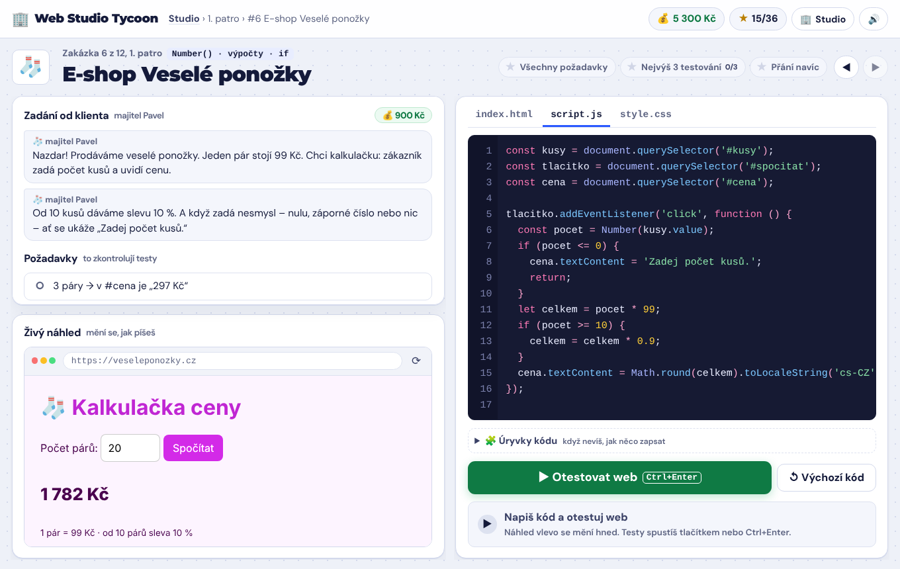
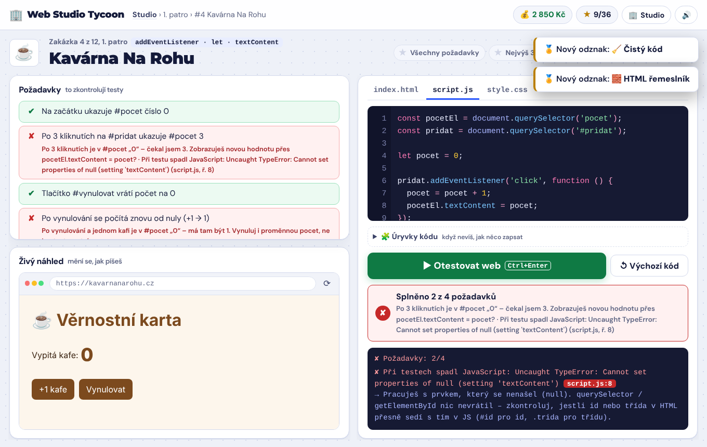
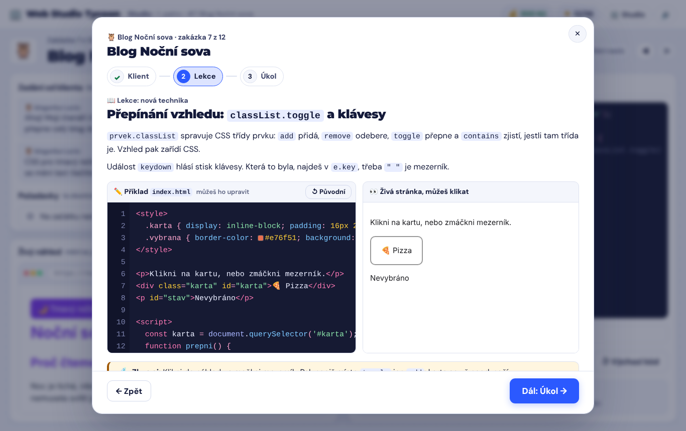
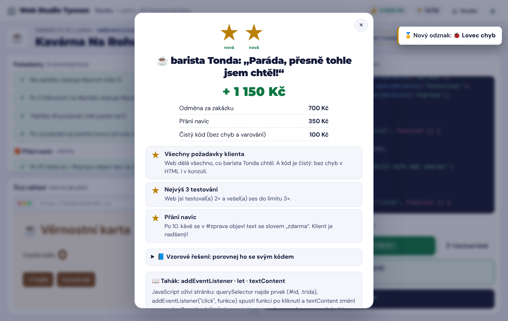
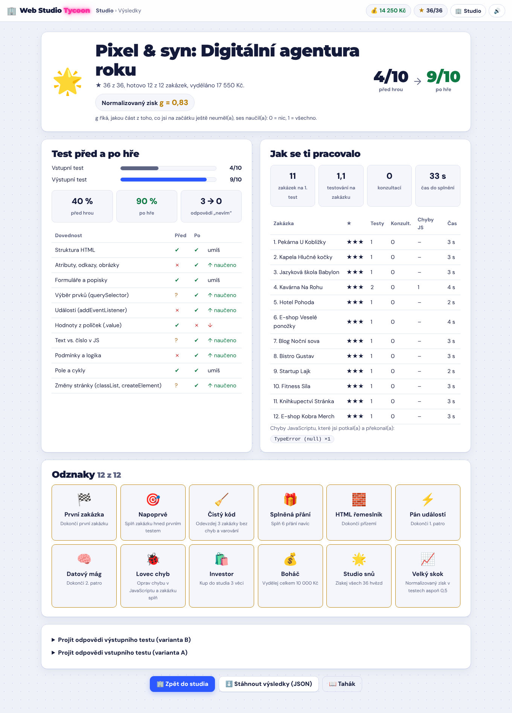

# 🏢 Web Studio Tycoon

**Vzdělávací budovatelská hra: vedeš vlastní webové studio a pro klienty stavíš weby ze skutečného HTML a JavaScriptu.** Pekárna chce vizitku, kapela odkazy a logo, kavárna věrnostní kartu, e-shop košík. Klient má požadavky, automatické testy je za tebe proklikají – a když všechno sedí, dostaneš zaplaceno a můžeš si vybavit studio.

- 🎮 **Hrát online:** https://UZIVATEL.github.io/web-studio/
- 💻 **Zdrojový kód:** https://github.com/UZIVATEL/web-studio

> Hra běží celá v prohlížeči (HTML + CSS + JavaScript, bez knihoven a bez serveru). Postup se ukládá do `localStorage`.



---

## 🎯 Záměr

Kdo se učí web, většinou píše „cvičení“ bez zadavatele: udělej tlačítko, vypiš text. Chybí mu otázka *proč* a hlavně zpětná vazba – stránka „nějak funguje“, ale nikdo nezkontroluje, jestli dělá přesně to, co má. Typické chyby (`querySelector('pocet')` bez mřížky, `"3" + 1`, `textContent` místo `value`, zapomenuté `preventDefault`) se pak opakují celé měsíce.

Web Studio Tycoon na to jde jako skutečná práce webového vývojáře:
- **Klient a zadání.** Každá zakázka má klienta (pekárna, hotel, blogerka, e-shop…), jeho slova a konkrétní požadavky – stejně jako v praxi.
- **Automatické testy jako akceptace.** Testy na skryté stránce klikají na tlačítka, píšou do políček a mačkají klávesy, a pak kontrolují výsledek. Když něco nesedí, napíšou proč: „Po vynulování a jednom kafi je v #pocet „5“ – má tam být 1. Vynuluj i proměnnou, ne jen text na stránce.“
- **Živý náhled a konzole.** Web se překresluje během psaní, chyby JavaScriptu se ukážou s číslem řádku v `script.js` a s vysvětlením česky. Kontrola HTML upozorní na neuzavřené značky, překlepy v názvech značek, duplicitní `id` nebo obrázek bez `alt`.

## 🕹️ Jak se hraje

1. **Založ studio a udělej vstupní test** (10 otázek, asi 3 minuty).
2. **Plň zakázky** – 12 zakázek ve 3 patrech. Kód píšeš do tří souborů (`index.html`, `script.js`, `style.css`), náhled se mění hned, `Ctrl+Enter` spustí testy.
3. **Vydělávej a vybavuj studio** – za peníze kupuješ vybavení (kávovar zlevní konzultace, druhý monitor zvětší náhled, kočka gratuluje…).
4. **Výstupní test a výsledky** – porovnání před/po, dovednost po dovednosti.

| Patro | Zakázky | Co se hráč naučí |
|---|---|---|
| 🧱 Přízemí – HTML | 1 Pekárna U Kobližky · 2 Kapela Hlučné kočky · 3 Jazyková škola | struktura (`h1`, `p`, `ul/li`), odkazy na sekce přes `id`, `target="_blank"`, obrázek s `alt`, formuláře (`input` typy, `select`, propojený `label`, `required`) |
| ⚡ 1. patro – JavaScript a události | 4 Kavárna (počítadlo) · 5 Hotel (pozdrav) · 6 E-shop s ponožkami (kalkulačka) · 7 Blog (tmavý režim) | `querySelector`, `addEventListener`, proměnné a stav, `textContent` × `.value`, `trim()`, `Number()` a výpočty, podmínky, `classList.toggle`, klávesy (`keydown`) |
| 🧠 2. patro – data a logika | 8 Bistro (menu z pole) · 9 Startup (úkoly) · 10 Fitness (registrace) · 11 Knihkupectví (vyhledávání) · 12 Kobra Merch (košík) | pole objektů a `for…of`, `createElement`/`appendChild`, události na nových prvcích, validace (`includes`, `length`, `else if`, regulární výraz), živé filtrování (`input`, `toLowerCase`, `hidden`), data-atributy, stav aplikace v poli a překreslování |

Testy hlídají i to, že řešení je **obecné**: v zakázce s menu test vymění data v poli `jidla` a kontroluje, jestli se menu změní – ručně napsané `<li>` neprojdou.



### 📖 Příběh → Lekce → Úkol

Každá zakázka začíná ve třech krocích:

1. 💬 **Příběh**: o co jde a proč to postavy potřebují.
2. 📖 **Lekce**: nová věc vysvětlená na vlastním příkladu, který si můžeš hned upravit; příklad je živá stránka, na kterou se dá rovnou klikat. U lekce je i „🧪 Zkus si“, „⚠️ Pozor“ na nejčastější chybu a zajímavost ze skutečného světa. Příklad je schválně jiný než úkol, takže lekce učí, ale neprozradí řešení.
3. 🎯 **Úkol**: co přesně udělat a za co dostaneš každou ze tří hvězd.

Lekci otevřeš kdykoli znovu tlačítkem **📖 Lekce** a v taháku (příručce) jsou lekce všech odemčených úrovní.



## 🎉 Proč je to zábavné

- **Budovatelská hra** – vlastní studio s názvem, peníze, výplatní páska po každé zakázce, obchod s vybavením, růst od 🚗 Garážového studia po 🌟 Digitální agenturu roku.
- **Pestré zakázky s osobností** – pekárna, garážová kapela, blogerka, šéfkuchař, startup, knihkupectví… a finále pro e-shop jednotky KOBRA (crossover s hrou Operace Kobra).
- **Tři hvězdy za zakázku** – ★ splnění, ★ nejvýš 3 testování, ★ přání navíc (např. „po 10. kávě nabídni kafe zdarma“, „klávesa D přepne režim“, „doprava zdarma od 1000 Kč“).
- **Odměny za kvalitu** – bonus za přání navíc a za čistý kód (žádná chyba v konzoli a žádné varování v HTML).
- **12 odznaků**, zvuky, konfety, kancelářská kočka 🐈.
- **Konzultace se seniorem** (nápovědy) stojí peníze – hráč zváží, jestli si poradí sám.
- **Hráč vždycky ví, co se děje.** V první úrovni ho provede průvodce obrazovkou (zadání, editor, spuštění, výsledky, hvězdy) a tlačítkem ❔ Průvodce si ho pustí kdykoli znovu. Bonus je vidět hned pod zadáním. Po vyřešení hra u každé hvězdy napíše, za co ji dostal, a u chybějící vysvětlí, jak ji získat, i s ukázkou kódu. Vzorové řešení si pak může rozbalit a porovnat se svým.
- **Přehledná obrazovka zakázky.** Nahoře klient, název zakázky a hvězdy. Vlevo zadání od klienta se seznamem požadavků (po testu zezelenají nebo zčervenají) a pod ním živý náhled webu, vpravo kód. Pod editorem je velké tlačítko **▶ Otestovat web** a hned pod ním stavový řádek s prvním nesplněným požadavkem. Úryvky kódu jsou schované v rozbalovacím pruhu, aby hráč programoval sám a nápovědu si otevřel, jen když ji potřebuje.



## 📈 Měřitelnost pokroku

**1. Vstupní a výstupní test (paralelní formy A/B)**
- 10 otázek na 10 dovedností: struktura HTML, atributy a odkazy, formuláře a popisky, výběr prvků (`querySelector`), události, hodnoty z políček, text vs. číslo v JS, podmínky, pole a cykly, změny stránky (`classList`, `createElement`).
- Varianta A/B se losuje (druhá je na konci) – výsledek nezkreslí zapamatované otázky. Odpovědi se míchají, volba **🤷 Nevím** omezuje hádání.
- **Normalizovaný zisk** (Hake) `g = (po − před) / (1 − před)` a **tabulka dovedností před/po**.

**2. Herní metriky (pro každou zakázku)**
- počet testování do splnění a splnění na první pokus,
- použité konzultace a zobrazení řešení,
- testování, při kterých spadl JavaScript, a **typy chyb** (ReferenceError, TypeError (null), SyntaxError, nekonečný cyklus…),
- testování s varováním v HTML,
- splněná přání navíc a čistý kód (kvalita), čas do splnění,
- ekonomika: vyděláno, utraceno, koupené vybavení.

**3. Export** – *Stáhnout výsledky (JSON)* uloží testy a odpovědi, dovednosti, statistiky zakázek, typy chyb, ekonomiku, odznaky a log událostí.



## ⚙️ Jak to funguje technicky

- **Stránka hráče v `<iframe srcdoc>`.** Z `index.html`, `style.css` a `script.js` se složí dokument; před kód hráče se vloží malý „bootstrap“, který zachytává `console.log`, chyby (`error`, `unhandledrejection`) i s číslem řádku ve `script.js` (díky `//# sourceURL`), zabrání odeslání formuláře a odchodu ze stránky po kliknutí na odkaz.
- **Ochrana proti nekonečným cyklům.** Vlastní lexikální průchod kódu (řetězce, komentáře, šablony) najde každé `while` a `for` a do jeho podmínky vloží kontrolu `__g()`, která po 3 milionech opakování cyklus ukončí chybou – prohlížeč nezamrzne. Čísla řádků se nemění.
- **Automatické testy požadavků.** Každý požadavek běží na čerstvě načtené skryté stránce; testovací pomocník umí `click`, `type` (vyvolá `input`/`change`/`keyup`), `key` (klávesy), kontrolu viditelnosti, čtení textů a dokonce znovunačtení stránky s upravenými daty.
- **Kontrola HTML.** Zásobníkový parser značek: neuzavřené a překřížené značky, uzavírání prázdných prvků (`</img>`), neznámé značky s návrhem opravy (`<buton>` → `<button>`), chybějící uvozovky a `>`, duplicitní `id`, obrázek bez `alt`, překlepy v atributech.
- **Chyby česky.** Nejčastější chyby JavaScriptu (`… is not defined`, `Cannot set properties of null`, `… is not a function`, `Assignment to constant variable`, syntaktické chyby…) dostanou srozumitelné vysvětlení.
- **Bez závislostí.** Čisté HTML/CSS/JS, `localStorage`, Web Audio, responzivní rozvržení.

## 🧪 Testy

`tests/test.html` (otevři v prohlížeči) – **193 kontrol**:
- běhové prostředí: instrumentace cyklů nemění řádky, nekonečný cyklus se zastaví a nahlásí na správném řádku, chyby v obsluze událostí i syntaktické chyby mají správné číslo řádku, zachytí se `console.log`, odeslání formuláře stránku nezničí, kontrola HTML najde typické chyby,
- každá zakázka: vzorové řešení splní všechny požadavky i přání navíc, nemá chyby v konzoli ani varování v HTML, výchozí kód neprojde a typické chyby začátečníků (např. vynulování jen textu, `jmeno` místo `jmeno.value`, sleva od `> 10` místo `>= 10`, `classList.add` místo `toggle`, ručně napsané menu, `[object Object]`, ceny sečtené jako text) neprojdou.
- **lekce**: každá úroveň má úplnou lekci (výklad, příklad, „Zkus si“, „Pozor“), příklad je platný kód, který jde spustit nebo vykreslit, a neprozradí řešení úrovně (jiné prvky a funkce, žádné opsané řádky).

## ▶️ Spuštění

- **Nejjednodušší:** otevři `index.html` v prohlížeči.
- **VS Code:** otevři složku a spusť přes *Run and Debug* (F5), nebo použij rozšíření *Live Server*.

### Nasazení na GitHub Pages

1. Vytvoř na GitHubu veřejný repozitář `web-studio` a nahraj do něj obsah této složky (`index.html` v kořeni).
2. **Settings → Pages → Build and deployment → Source: Deploy from a branch**, větev `main`, složka `/ (root)` → **Save**.
3. Za minutu je hra na `https://UZIVATEL.github.io/web-studio/`. Odkazy nahoře v README přepiš na skutečné.

## 📁 Struktura

```
web-studio/
├── index.html          – kostra aplikace (+ skrytý iframe pro testy)
├── css/base.css        – společná kostra obrazovek (lišta, kvíz, mapa, zakázka, výsledky)
├── css/style.css       – vzhled studia (plátno s mřížkou jako v grafickém editoru)
├── fonts/              – písma DM Sans a Montserrat (licence SIL OFL)
├── js/kit.js           – úložiště, zvuky, okna, kvíz, export
├── js/editor.js        – editor kódu se zvýrazněním HTML, CSS a JS
├── js/studio.js        – sestavení stránky, ochrana cyklů, kontrola HTML, testy, chyby česky
├── js/orders.js        – 12 zakázek, požadavky a jejich testy, kvíz A/B
├── js/lessons.js       – lekce ke každé úrovni: výklad, příklad, zkus si, pozor
├── js/lesson.js        – společný úvod úrovně (Příběh → Lekce → Úkol) a živé příklady
├── js/app.js           – studio, zakázky, peníze, obchod, odznaky, měření, výsledky
├── tests/test.html     – automatické testy
├── tests/lessons-check.js– kontrola lekcí (úplnost, platný kód, neprozradí řešení)
└── screenshots/        – obrázky do README
```

---

Vytvořeno jako semestrální projekt **4ITE PHR – EduGame**. Všichni klienti, firmy a domény jsou smyšlené.
